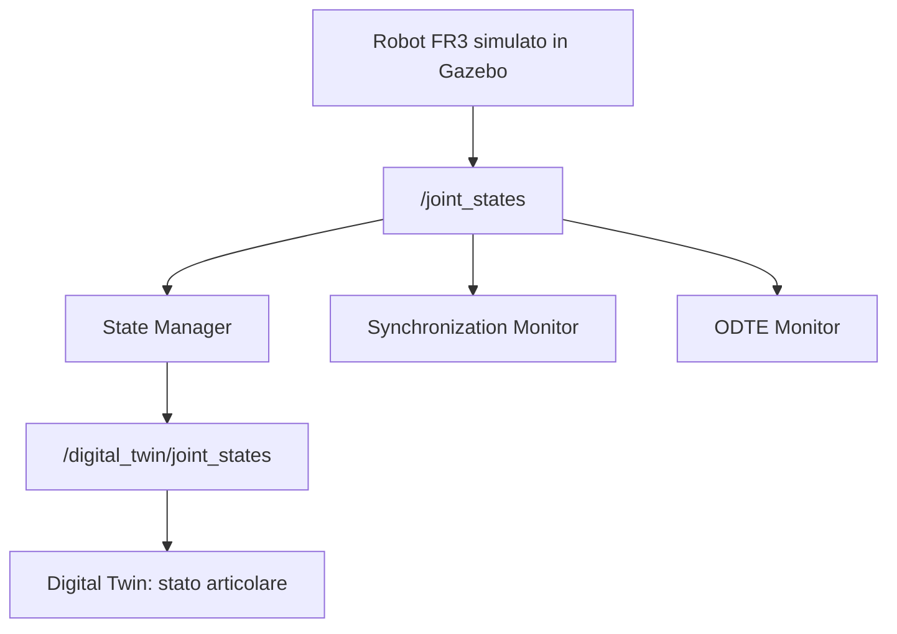
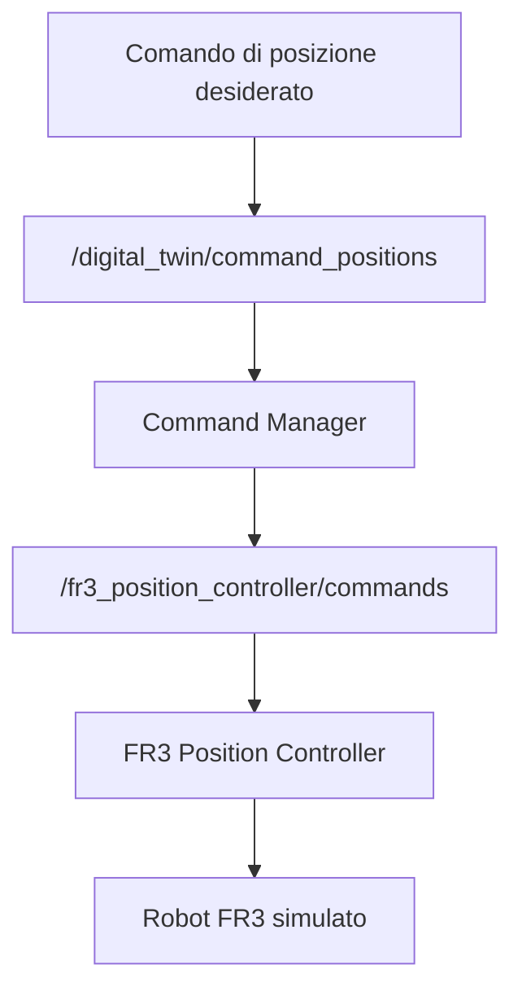
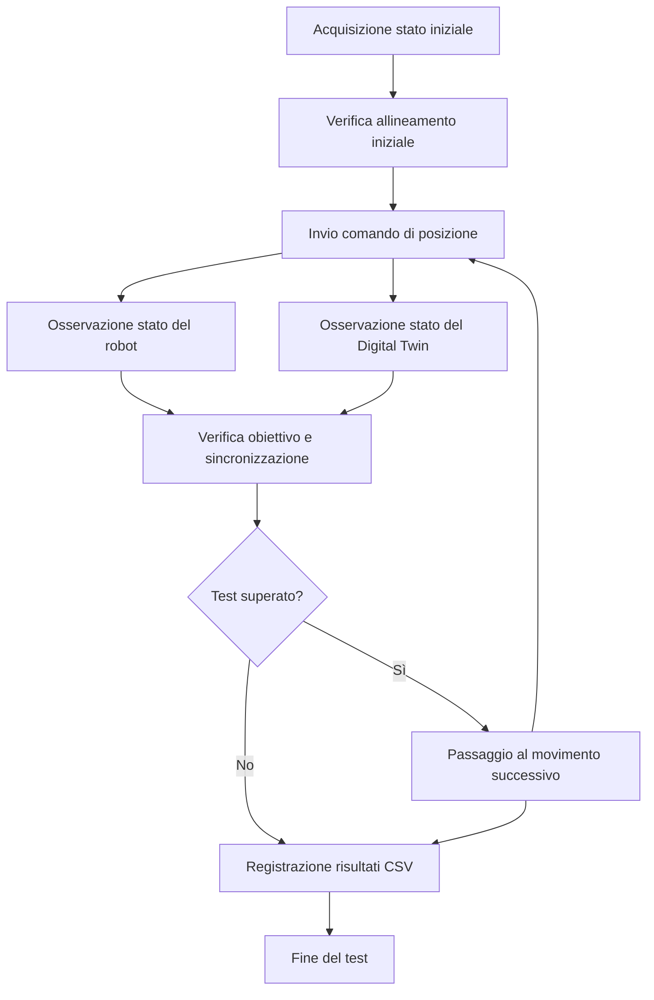

# Franka Digital Twin

## Descrizione del progetto

Il progetto mira alla realizzazione di un **Digital Twin del robot Franka FR3**, utilizzando ROS 2 Jazzy e Gazebo per la simulazione e lo sviluppo di un sistema in grado di acquisire lo stato del robot, inviare comandi di movimento e monitorare la sincronizzazione tra il robot simulato e la sua rappresentazione digitale.

L'architettura è organizzata in nodi ROS 2 modulari, ciascuno con responsabilità specifiche per la gestione dei comandi, l'acquisizione dello stato articolare, il monitoraggio della sincronizzazione e la verifica del comportamento del sistema.

Il progetto comprende inoltre un primo prototipo sperimentale per il calcolo della metrica **ODTE (Overall Digital Twin Entanglement)**, attualmente in fase di sviluppo e validazione.

---

## Obiettivi

Gli obiettivi principali del progetto sono:

- Configurare l'ambiente ROS 2 Jazzy e Gazebo per simulare il robot Franka FR3.
- Acquisire e monitorare lo stato delle sette articolazioni del robot.
- Implementare un nodo per la gestione e l'inoltro dei comandi di posizione.
- Pubblicare lo stato articolare acquisito su un topic dedicato al Digital Twin.
- Monitorare la freschezza degli aggiornamenti dello stato del robot.
- Verificare il raggiungimento delle posizioni articolari desiderate.
- Verificare l'allineamento tra lo stato del robot simulato e quello pubblicato dal Digital Twin.
- Registrare i risultati dei test in file CSV.
- Sviluppare un prototipo sperimentale per il calcolo della metrica ODTE.
- Mantenere il progetto modulare e organizzato tramite Git.

---

## Tecnologie utilizzate

| Tecnologia | Utilizzo |
|---|---|
| Ubuntu 24.04 | Sistema operativo |
| ROS 2 Jazzy | Middleware per la comunicazione tra i nodi |
| Gazebo | Simulazione del robot Franka FR3 |
| Python | Implementazione dei nodi ROS 2 e dei test |
| Git | Controllo di versione |
| GitHub | Repository del progetto |

---

## Architettura del sistema

Il sistema è organizzato in nodi ROS 2 distinti, che comunicano attraverso topic dedicati.

### 1. State Manager

Il nodo `state_manager.py` acquisisce lo stato articolare del robot attraverso `/joint_states` e pubblica una rappresentazione filtrata dello stato su `/digital_twin/joint_states`.

Le principali responsabilità sono:

- Ricevere gli aggiornamenti dello stato articolare.
- Verificare la presenza delle sette articolazioni del braccio FR3.
- Controllare la coerenza tra nomi dei giunti e posizioni ricevute.
- Rifiutare gli aggiornamenti contenenti posizioni non finite.
- Mantenere una rappresentazione digitale interna dello stato articolare.
- Pubblicare i sette giunti in un ordine deterministico.
- Rendere disponibili, quando presenti, anche le informazioni di velocità e sforzo articolare.
- Visualizzare periodicamente lo stato acquisito.

Il topic `/digital_twin/joint_states` utilizza il tipo di messaggio `sensor_msgs/msg/JointState`.

### 2. Command Manager

Il nodo `command_manager.py` gestisce l'invio dei comandi di posizione al robot simulato.

Riceve i comandi attraverso `/digital_twin/command_positions` e li inoltra al controller attraverso `/fr3_position_controller/commands`.

Le principali responsabilità sono:

- Ricevere un array contenente le posizioni articolari desiderate.
- Verificare che il comando contenga esattamente sette valori.
- Verificare che i valori siano numerici e finiti.
- Inoltrare i comandi validi al controller del robot.

Il componente permette di inviare comandi attraverso un'interfaccia dedicata al Digital Twin, separando la generazione del comando dalla comunicazione con il controller.

### 3. Synchronization Monitor

Il nodo `synchronization_monitor.py` controlla la freschezza degli aggiornamenti ricevuti attraverso `/joint_states`.

Il monitor utilizza una soglia di **2 secondi** per individuare eventuali interruzioni o ritardi significativi nella ricezione dei dati.

Le principali responsabilità sono:

- Verificare la presenza delle sette articolazioni richieste.
- Registrare l'istante di ricezione degli aggiornamenti validi.
- Controllare periodicamente da quanto tempo non vengono ricevuti nuovi dati.
- Segnalare il passaggio a uno stato non sincronizzato.
- Segnalare il ripristino della ricezione regolare degli aggiornamenti.

Il monitor verifica la freschezza dei dati ricevuti, ma non costituisce da solo una misura completa dell'errore tra lo stato del robot e quello del Digital Twin.

### 4. Tracking Test

Il modulo `tracking_test.py` verifica la capacità del sistema di raggiungere simultaneamente determinate posizioni articolari.

Il test coinvolge le articolazioni:

- `fr3_joint2`
- `fr3_joint4`
- `fr3_joint7`

Le posizioni obiettivo vengono ottenute applicando le seguenti variazioni:

| Articolazione | Variazione richiesta |
|---|---:|
| `fr3_joint2` | +0.03 rad |
| `fr3_joint4` | +0.03 rad |
| `fr3_joint7` | -0.03 rad |

I parametri utilizzati per il test sono:

| Parametro | Valore |
|---|---:|
| Tolleranza sulla posizione | 0.01 rad |
| Durata minima di stabilità | 0.5 s |
| Timeout | 10 s |

Il test verifica che le articolazioni coinvolte raggiungano i rispettivi obiettivi entro la tolleranza prevista e rimangano stabili per il tempo richiesto.

I risultati vengono salvati in un file CSV nella cartella `results/`.

### 5. Full Sequence Test

Il modulo `full_sequence_test.py` verifica il comportamento del sistema durante una sequenza composta da tre movimenti consecutivi.

Il test coinvolge tutte e sette le articolazioni del braccio FR3.

Le principali fasi della verifica sono:

- Acquisizione dello stato iniziale del robot e del Digital Twin.
- Verifica dell'allineamento iniziale tra le due rappresentazioni.
- Invio di tre diversi comandi di posizione.
- Verifica del raggiungimento delle posizioni obiettivo.
- Confronto tra le posizioni del robot simulato e quelle pubblicate dal Digital Twin.
- Verifica della stabilità delle posizioni raggiunte.
- Registrazione dei risultati in un file CSV.

I parametri di verifica sono:

| Parametro | Valore |
|---|---:|
| Numero di articolazioni | 7 |
| Numero di movimenti | 3 |
| Tolleranza sulla posizione | 0.01 rad |
| Durata minima di stabilità | 0.5 s |
| Timeout per il movimento | 10 s |

Il test confronta tre grandezze:

- **Posizione obiettivo:** valore articolare richiesto dal comando.
- **Posizione del robot:** valore osservato attraverso `/joint_states`.
- **Posizione del Digital Twin:** valore osservato attraverso `/digital_twin/joint_states`.

In questo modo è possibile verificare sia il raggiungimento del comando sia l'allineamento tra lo stato del robot simulato e quello pubblicato dal Digital Twin.

I risultati vengono salvati in un file CSV nella cartella `results/`.

### 6. ODTE Monitor

Il modulo `odte_monitor.py` implementa un primo prototipo sperimentale per il monitoraggio della metrica ODTE.

Il nodo:

- Si sottoscrive al topic `/joint_states`.
- Verifica la presenza delle sette articolazioni richieste.
- Controlla che le posizioni ricevute siano finite.
- Elabora le informazioni temporali disponibili.
- Calcola una stima preliminare delle componenti della metrica.
- Pubblica i risultati in formato JSON attraverso `/digital_twin/odte`.

Il messaggio pubblicato utilizza il tipo ROS 2 `std_msgs/msg/String`.

**Nota importante:** questa implementazione è sperimentale e non costituisce ancora una riproduzione scientificamente validata della metrica ODTE descritta in letteratura.

Le componenti temporali, il calcolo della frequenza di aggiornamento e la gestione della disponibilità richiedono ulteriori verifiche. I valori prodotti devono quindi essere interpretati come risultati preliminari, non come una misura definitiva della qualità del Digital Twin.

---

## Architettura della comunicazione

### Acquisizione e pubblicazione dello stato

Il flusso di acquisizione dello stato è il seguente:



Il robot simulato pubblica lo stato articolare su `/joint_states`.

Lo State Manager verifica i dati ricevuti e pubblica lo stato filtrato su `/digital_twin/joint_states`.

Il Synchronization Monitor e l'ODTE Monitor ricevono gli aggiornamenti da `/joint_states` per svolgere le rispettive attività di monitoraggio.

### Invio dei comandi

Il flusso dei comandi è il seguente:



Il Command Manager riceve il comando, ne verifica la validità e inoltra le posizioni al controller del robot simulato.

### Verifica della sequenza di movimento

Il test completo utilizza il seguente flusso logico:



---

## Topic ROS 2

I principali topic utilizzati dal progetto sono riportati nella tabella seguente.

| Topic | Tipo di messaggio | Funzione |
|---|---|---|
| `/joint_states` | `sensor_msgs/msg/JointState` | Pubblicazione dello stato articolare del robot |
| `/digital_twin/joint_states` | `sensor_msgs/msg/JointState` | Pubblicazione dello stato articolare filtrato del Digital Twin |
| `/digital_twin/command_positions` | `std_msgs/msg/Float64MultiArray` | Ricezione dei comandi di posizione desiderati |
| `/fr3_position_controller/commands` | `std_msgs/msg/Float64MultiArray` | Invio dei comandi al controller di posizione |
| `/digital_twin/odte` | `std_msgs/msg/String` | Pubblicazione delle metriche ODTE in formato JSON |

---

## Requisiti

Per eseguire il progetto è necessario disporre di:

- Ubuntu 24.04.
- ROS 2 Jazzy installato e configurato.
- Un workspace contenente i componenti ROS 2 necessari per la simulazione del Franka FR3.
- Gazebo e i pacchetti di simulazione del robot.
- Python e gli strumenti di compilazione ROS 2.
- Il package `franka_dt` presente nel repository.

Il progetto utilizza due workspace:

- `franka_ros2_ws`: contiene i componenti necessari per la simulazione del robot.
- `franka_digital_twin`: contiene il package sviluppato per il Digital Twin.

---

## Compilazione del progetto

Prima di compilare il package, caricare gli ambienti ROS 2 necessari:

```bash
source /opt/ros/jazzy/setup.bash
source ~/franka_ros2_ws/install/setup.bash
```

Spostarsi nella cartella del repository:

```bash
cd ~/franka_digital_twin
```

Compilare il package `franka_dt`:

```bash
colcon build --packages-select franka_dt --symlink-install
```

Dopo la compilazione, caricare l'ambiente del package:

```bash
source ~/franka_digital_twin/install/setup.bash
```

Per utilizzare i nodi del progetto in un nuovo terminale, caricare gli ambienti necessari:

```bash
source /opt/ros/jazzy/setup.bash
source ~/franka_ros2_ws/install/setup.bash
source ~/franka_digital_twin/install/setup.bash
```

---

## Avvio della simulazione

Per avviare la simulazione del Franka FR3 con il controller di posizione e la mano del robot, eseguire:

```bash
source /opt/ros/jazzy/setup.bash
source ~/franka_ros2_ws/install/setup.bash

ros2 launch franka_gazebo_bringup gazebo_franka_arm_example_controller.launch.py \
  load_gripper:=true \
  franka_hand:='franka_hand' \
  controller:='fr3_position_controller'
```

Una volta avviata la simulazione, verificare che i topic siano disponibili:

```bash
ros2 topic list
```

Per visualizzare gli aggiornamenti dello stato articolare:

```bash
ros2 topic echo /joint_states
```

Per visualizzare lo stato articolare pubblicato dal Digital Twin:

```bash
ros2 topic echo /digital_twin/joint_states
```

---

## Esecuzione dei nodi

Prima di eseguire ciascun nodo in un nuovo terminale, caricare gli ambienti ROS 2:

```bash
source /opt/ros/jazzy/setup.bash
source ~/franka_ros2_ws/install/setup.bash
source ~/franka_digital_twin/install/setup.bash
```

### State Manager

Avvia il nodo responsabile dell'acquisizione e della pubblicazione dello stato articolare:

```bash
ros2 run franka_dt state_manager
```

### Command Manager

Avvia il nodo responsabile della gestione dei comandi di posizione:

```bash
ros2 run franka_dt command_manager
```

### Synchronization Monitor

Avvia il monitor della freschezza degli aggiornamenti:

```bash
ros2 run franka_dt synchronization_monitor
```

### Tracking Test

Avvia il test di tracking delle articolazioni selezionate:

```bash
ros2 run franka_dt tracking_test
```

### Full Sequence Test

Avvia il test completo composto da tre movimenti consecutivi:

```bash
ros2 run franka_dt full_sequence_test
```

Il test richiede che la simulazione del robot e i componenti necessari alla gestione dei comandi e dello stato siano già in esecuzione.

Al termine, i risultati vengono salvati in un file CSV nella cartella `results/` del repository.

### ODTE Monitor

Avvia il prototipo sperimentale per il calcolo della metrica ODTE:

```bash
ros2 run franka_dt odte_monitor --ros-args \
  -p use_sim_time:=true \
  -p expected_rate_hz:=100.0 \
  -p desired_timeliness_ms:=50.0 \
  -p window_seconds:=10.0
```

I parametri configurabili sono:

| Parametro | Valore utilizzato | Descrizione |
|---|---:|---|
| `use_sim_time` | `true` | Utilizza il tempo di simulazione ROS |
| `expected_rate_hz` | `100.0` | Frequenza di aggiornamento attesa |
| `desired_timeliness_ms` | `50.0` | Soglia temporale desiderata, espressa in millisecondi |
| `window_seconds` | `10.0` | Finestra temporale utilizzata per il monitoraggio |

La frequenza attesa e la soglia temporale sono parametri configurabili e non rappresentano necessariamente le prestazioni effettive del sistema.

Per osservare i risultati pubblicati:

```bash
ros2 topic echo /digital_twin/odte
```

I dati vengono pubblicati come messaggi `std_msgs/msg/String` contenenti informazioni in formato JSON.

---

## Test e risultati

### 1. Verifica dell'acquisizione dello stato

L'acquisizione dello stato è stata verificata attraverso il topic `/joint_states`.

È stata inoltre verificata la pubblicazione dello stato articolare filtrato attraverso `/digital_twin/joint_states`.

Il messaggio pubblicato dal Digital Twin contiene i sette giunti del braccio FR3 in un ordine deterministico e riporta le posizioni articolari corrispondenti allo stato acquisito.

### 2. Verifica del Command Manager

È stata verificata la possibilità di inviare un comando di posizione attraverso `/digital_twin/command_positions` e inoltrarlo al controller del robot simulato.

Durante una delle prove, la posizione di riferimento di `fr3_joint7` è stata modificata da:

```text
0.912627344 rad
```

a:

```text
0.922627344 rad
```

La variazione richiesta è pari a:

```text
+0.01 rad
```

Il test è stato utilizzato per verificare il percorso del comando dal nodo di gestione fino al controller.

### 3. Verifica del Synchronization Monitor

Il monitor è stato verificato simulando un'interruzione degli aggiornamenti dello stato articolare.

La procedura prevede l'arresto e il successivo riavvio del `joint_state_broadcaster`, in modo da osservare il comportamento del monitor quando gli aggiornamenti non arrivano più e quando riprendono.

La soglia utilizzata per identificare uno stato non aggiornato è di 2 secondi.

### 4. Tracking Test

Il test di tracking verifica il raggiungimento simultaneo delle posizioni desiderate per `fr3_joint2`, `fr3_joint4` e `fr3_joint7`.

Le variazioni richieste sono:

| Articolazione | Variazione |
|---|---:|
| `fr3_joint2` | +0.03 rad |
| `fr3_joint4` | +0.03 rad |
| `fr3_joint7` | -0.03 rad |

I parametri di verifica sono:

| Parametro | Valore |
|---|---:|
| Tolleranza | 0.01 rad |
| Stabilità richiesta | 0.5 s |
| Timeout massimo | 10 s |

Sono state completate due esecuzioni del test con esito positivo, con un tempo di completamento di circa 0.601 secondi.

In una delle esecuzioni, gli errori assoluti finali riportati sono stati:

| Articolazione | Errore assoluto finale |
|---|---:|
| `fr3_joint2` | 0.000000 rad |
| `fr3_joint4` | 0.000000 rad |
| `fr3_joint7` | 0.000000 rad |

Gli errori massimi registrati durante il test sono stati:

| Articolazione | Errore massimo |
|---|---:|
| `fr3_joint2` | 0.020751 rad |
| `fr3_joint4` | 0.016329 rad |
| `fr3_joint7` | 0.009414 rad |

I valori sono riportati con la precisione disponibile nell'output del test. Gli errori finali visualizzati come `0.000000` possono essere soggetti ad arrotondamento.

### 5. Full Sequence Test

Il test completo è stato eseguito con successo utilizzando tutte e sette le articolazioni del braccio FR3.

Sono stati verificati tre movimenti consecutivi:

- Primo movimento: variazione positiva di 0.02 rad rispetto allo stato iniziale per ciascun giunto.
- Secondo movimento: variazione negativa di 0.02 rad rispetto allo stato iniziale per ciascun giunto.
- Terzo movimento: variazioni alternate di +0.01 rad e -0.01 rad rispetto allo stato iniziale.

Per ogni movimento il test ha verificato:

- Il raggiungimento delle posizioni obiettivo entro la tolleranza di 0.01 rad.
- L'allineamento tra le posizioni del robot e quelle pubblicate dal Digital Twin.
- Il mantenimento della stabilità per almeno 0.5 secondi.

L'esecuzione verificata si è conclusa con esito positivo per tutti e tre i movimenti.

I tempi di completamento registrati sono stati:

| Movimento | Tempo di completamento |
|---|---:|
| 1 | 0.947 s |
| 2 | 0.798 s |
| 3 | 0.649 s |

Il test ha registrato 21 righe di risultati complessive, corrispondenti a tre movimenti e sette articolazioni.

I valori di errore riportati dal riepilogo del CSV risultavano pari a `0.000000 rad` alla precisione di sei cifre decimali. Questo risultato indica errori inferiori alla precisione visualizzata, non necessariamente un errore matematico esattamente nullo.

Il file dei risultati è stato salvato in:

```text
results/full_sequence_test_20261023_101704.csv
```
Il file CSV viene salvato localmente nella cartella `results/`, esclusa dal controllo di versione tramite `.gitignore`. Di conseguenza, il file non viene pubblicato automaticamente su GitHub.

Questi risultati documentano il comportamento osservato durante la specifica esecuzione del test e non costituiscono una valutazione generale delle prestazioni temporali del sistema.

### 6. ODTE Monitor: risultati preliminari

È stato avviato il nodo sperimentale `odte_monitor.py`, che pubblica i risultati sul topic `/digital_twin/odte`.

Durante le prove sono stati osservati messaggi di questo tipo:

```text
[INFO] ODTE Monitor avviato: percorso Physical -> Digital.
[WARN] ODTE non ancora calcolabile: servono almeno due aggiornamenti validi.
[INFO] T=1.000 | R=0.006 | A=1.000 | ODTE=0.006
[INFO] T=1.000 | R=1.000 | A=1.000 | ODTE=1.000
```

Il primo avviso indica che, all'avvio, il monitor necessita di almeno due aggiornamenti validi prima di effettuare il calcolo.

Successivamente, il nodo ha iniziato a pubblicare messaggi JSON sul topic `/digital_twin/odte`, contenenti le informazioni relative alla direzione del flusso, alla tempestività, all'affidabilità, alla disponibilità e al valore complessivo ODTE.

Un esempio della struttura dei dati pubblicati è:

```json
{
  "direction": "physical_to_digital",
  "timeliness": 1.0,
  "reliability": 1.0,
  "availability": 1.0,
  "odte": 1.0
}
```

Questo JSON illustra la struttura del messaggio osservato e non rappresenta un risultato di validazione scientifica della metrica.

#### Precisazioni sull'implementazione ODTE

Il monitor costituisce un **prototipo sperimentale**. I risultati ottenuti finora dimostrano che il nodo può avviarsi, ricevere aggiornamenti e pubblicare valori calcolati, ma non dimostrano che la metrica sia implementata in modo scientificamente equivalente alla formulazione originale.

In particolare:

- **Timeliness (`T`)**: viene stimata attraverso le informazioni temporali disponibili. La correttezza della stima dipende dalla coerenza dei timestamp e dalla gestione del tempo di simulazione.
- **Reliability (`R`)**: viene stimata in funzione della frequenza di aggiornamento osservata rispetto alla frequenza attesa. Il metodo di calcolo richiede ulteriori verifiche.
- **Availability (`A`)**: nella versione attuale è impostata a 1 e non costituisce una misura indipendente della disponibilità del sistema.
- **Tempo di esecuzione**: la misura attuale non rappresenta ancora una misura attendibile del tempo necessario per elaborare un aggiornamento completo del Digital Twin.
- **Valore ODTE**: viene calcolato combinando le componenti implementate, ma deve essere interpretato alla luce delle limitazioni descritte.

Di conseguenza, un valore `ODTE = 1.0` non dimostra, da solo, una sincronizzazione perfetta tra il robot e il Digital Twin.

Per rendere il monitor più rigoroso sarà necessario verificare la formulazione matematica originale, definire chiaramente i timestamp di riferimento, misurare il tempo di elaborazione effettivo e validare separatamente ciascuna componente della metrica.

---

## Struttura del repository

La struttura principale del repository è organizzata come segue:

```text
franka_digital_twin/
├── README.md
├── docs/
│   └── architecture.md
├── results/                 # Risultati locali, esclusi da Git
├── .gitignore
└── franka_dt/
    ├── franka_dt/
    │   ├── __init__.py
    │   ├── command_manager.py
    │   ├── state_manager.py
    │   ├── synchronization_monitor.py
    │   ├── odte_monitor.py
    │   ├── tracking_test.py
    │   └── full_sequence_test.py
    ├── resource/
    ├── test/
    ├── package.xml
    ├── setup.py
    └── setup.cfg
```

La cartella `results/` contiene i risultati dei test, mentre `docs/` contiene la documentazione tecnica dell'architettura.

La struttura riportata descrive l'organizzazione principale del progetto; i file effettivamente presenti possono variare in base allo stato corrente del repository.

---

## Stato attuale del progetto

### Funzionalità implementate

- Configurazione dell'ambiente ROS 2 Jazzy e Gazebo per il robot Franka FR3.
- Acquisizione dello stato articolare tramite `/joint_states`.
- Validazione di base dei messaggi di stato.
- Pubblicazione dello stato articolare filtrato tramite `/digital_twin/joint_states`.
- Gestione e inoltro dei comandi di posizione.
- Monitoraggio della freschezza degli aggiornamenti dello stato.
- Test del raggiungimento simultaneo di posizioni articolari.
- Test completo di una sequenza di tre movimenti sulle sette articolazioni.
- Verifica dell'allineamento tra lo stato del robot e quello pubblicato dal Digital Twin.
- Salvataggio dei risultati dei test in formato CSV.
- Primo prototipo sperimentale di monitoraggio ODTE con pubblicazione di messaggi JSON.

### Sviluppi futuri

- Consolidare la documentazione dell'architettura.
- Ampliare i test automatici dei nodi ROS 2.
- Migliorare la gestione e la validazione dei comandi.
- Valutare quantitativamente la frequenza di aggiornamento e la sincronizzazione tra robot e Digital Twin.
- Verificare la formulazione matematica originale della metrica ODTE.
- Migliorare il calcolo di timeliness, reliability e availability.
- Misurare correttamente il tempo di elaborazione del Digital Twin.
- Validare sperimentalmente i risultati della metrica ODTE in scenari differenti.

---

## Documentazione

La documentazione tecnica dell'architettura del sistema è organizzata nel file:

```text
docs/architecture.md
```

Il documento descrive l'organizzazione dei componenti, i flussi di comunicazione, i topic ROS 2 e le responsabilità dei nodi principali.

---

## Controllo di versione

Il progetto utilizza **Git** per il controllo di versione e **GitHub** per ospitare il repository e condividere il codice sorgente.

---

## Nota conclusiva

Il progetto costituisce una base per lo sviluppo di un Digital Twin del Franka FR3 in ambiente ROS 2 e Gazebo.

Le funzionalità di acquisizione dello stato, gestione dei comandi e tracking sono state implementate e testate negli scenari descritti. Il nuovo `state_manager` pubblica inoltre una rappresentazione articolare filtrata su un topic dedicato al Digital Twin.

Il `full_sequence_test` ha verificato con esito positivo una sequenza di tre movimenti, controllando il raggiungimento delle posizioni obiettivo e l'allineamento tra le posizioni del robot simulato e quelle pubblicate dal Digital Twin.

Il monitor ODTE è invece da considerarsi una componente sperimentale, che richiede ulteriori verifiche teoriche e sperimentali prima di poter essere utilizzata come misura validata della qualità della sincronizzazione.
