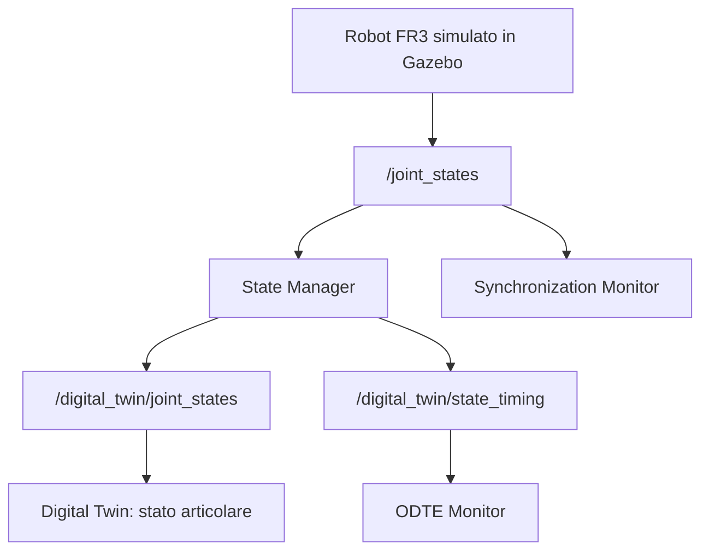
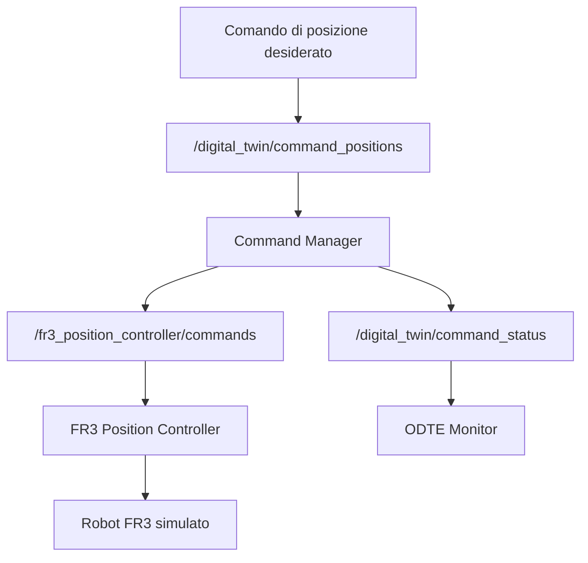
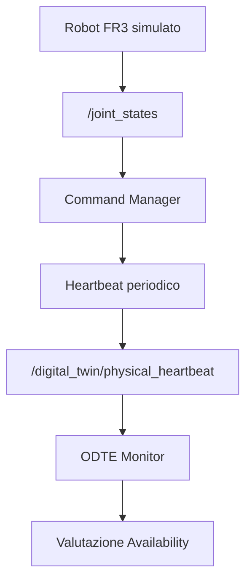
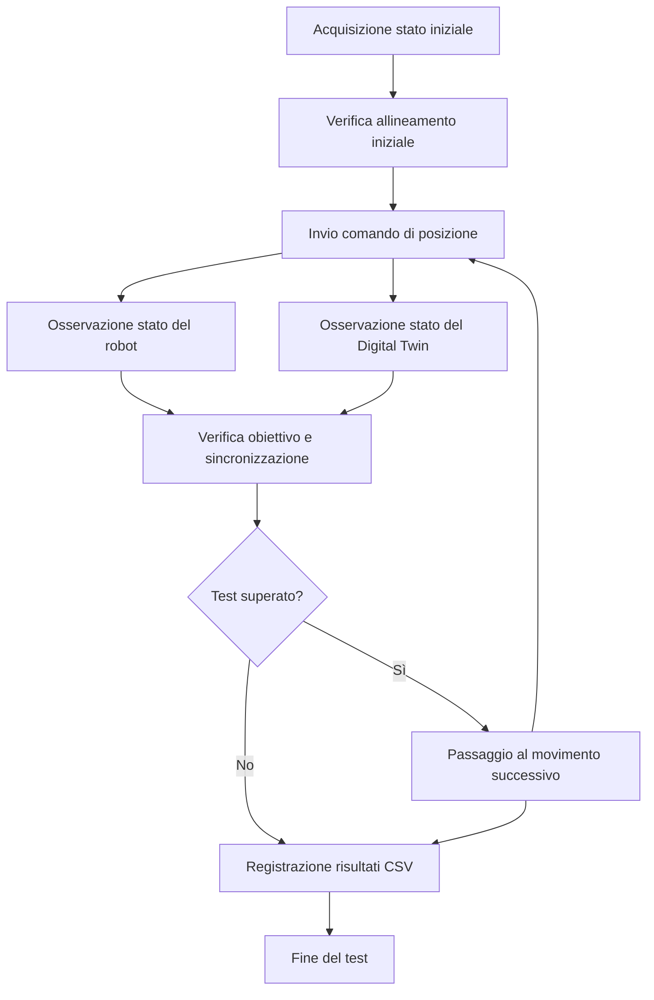

# Franka Digital Twin

## Descrizione del progetto

Il progetto mira alla realizzazione di un **Digital Twin del robot Franka FR3**, utilizzando ROS 2 Jazzy e Gazebo per la simulazione e lo sviluppo di un sistema in grado di acquisire lo stato del robot, inviare comandi di movimento e monitorare la sincronizzazione tra il robot simulato e la sua rappresentazione digitale.

L'architettura è organizzata in nodi ROS 2 modulari, ciascuno con responsabilità specifiche per la gestione dei comandi, l'acquisizione dello stato articolare, il monitoraggio della sincronizzazione e la verifica del comportamento del sistema.

Il progetto comprende inoltre un prototipo sperimentale per il calcolo della metrica **ODTE (Overall Digital Twin Entanglement)**, basato sul monitoraggio delle due direzioni di comunicazione tra il robot fisico (nel progetto, simulato) e il Digital Twin:

- **Physical → Digital (P→D):** monitoraggio del trasferimento dello stato articolare dal robot al Digital Twin.
- **Digital → Physical (D→P):** monitoraggio del trasferimento dei comandi dal Digital Twin al robot.

L'implementazione ODTE è attualmente sperimentale e viene sottoposta a verifiche funzionali e sperimentali.

---

## Obiettivi

Gli obiettivi principali del progetto sono:

- Configurare l'ambiente ROS 2 Jazzy e Gazebo per simulare il robot Franka FR3.
- Acquisire e monitorare lo stato delle sette articolazioni del robot.
- Implementare un nodo per la gestione e l'inoltro dei comandi di posizione.
- Pubblicare lo stato articolare acquisito su un topic dedicato al Digital Twin.
- Verificare la validità e la coerenza degli aggiornamenti dello stato articolare.
- Monitorare la freschezza degli aggiornamenti dello stato del robot.
- Verificare il raggiungimento delle posizioni articolari desiderate.
- Verificare l'allineamento tra lo stato del robot simulato e quello pubblicato dal Digital Twin.
- Monitorare la disponibilità degli aggiornamenti provenienti dal robot.
- Sviluppare un prototipo sperimentale per il calcolo della metrica ODTE in entrambe le direzioni.
- Implementare test automatici per verificare il comportamento dei principali componenti.
- Registrare i risultati dei test sperimentali in file CSV.
- Mantenere il progetto modulare e organizzato tramite Git.

---

## Tecnologie utilizzate

| Tecnologia | Utilizzo |
|---|---|
| Ubuntu 24.04 | Sistema operativo |
| ROS 2 Jazzy | Middleware per la comunicazione tra i nodi |
| Gazebo | Simulazione del robot Franka FR3 |
| Python | Implementazione dei nodi ROS 2 e dei test |
| pytest | Esecuzione dei test automatici |
| Git | Controllo di versione |
| GitHub | Repository del progetto |

---

## Architettura del sistema

Il sistema è organizzato in nodi ROS 2 distinti, che comunicano attraverso topic dedicati.

### 1. State Manager

Il nodo `state_manager.py` acquisisce lo stato articolare del robot attraverso `/joint_states` e pubblica una rappresentazione filtrata dello stato su `/digital_twin/joint_states`.

Le principali responsabilità sono:

- Ricevere gli aggiornamenti dello stato articolare.
- Verificare la coerenza tra il numero dei nomi dei giunti e il numero delle posizioni ricevute.
- Verificare la presenza delle sette articolazioni del braccio FR3.
- Controllare che le posizioni articolari siano valori finiti.
- Mantenere una rappresentazione digitale interna dello stato articolare.
- Pubblicare i sette giunti in un ordine deterministico.
- Rendere disponibili, quando presenti per tutti i giunti, anche le informazioni di velocità e sforzo articolare.
- Registrare le informazioni temporali relative alla generazione, alla ricezione e all'elaborazione degli aggiornamenti.

Il topic `/digital_twin/joint_states` utilizza il tipo di messaggio `sensor_msgs/msg/JointState`.

Il nodo pubblica inoltre le informazioni temporali attraverso:

- `/digital_twin/state_timing`

Il messaggio temporale viene pubblicato utilizzando `std_msgs/msg/String` e contiene un oggetto JSON con i seguenti campi:

| Campo | Descrizione |
|---|---|
| `generation_timestamp` | Timestamp associato alla generazione dello stato |
| `reception_timestamp` | Timestamp di ricezione dello stato |
| `processing_time_seconds` | Tempo impiegato per l'elaborazione del messaggio |

Queste informazioni vengono utilizzate dal monitor ODTE per la valutazione del percorso Physical → Digital.

### 2. Command Manager

Il nodo `command_manager.py` gestisce l'invio dei comandi di posizione al robot simulato.

Riceve i comandi attraverso `/digital_twin/command_positions` e li inoltra al controller attraverso `/fr3_position_controller/commands`.

Le principali responsabilità sono:

- Ricevere un array contenente le posizioni articolari desiderate.
- Verificare che il comando contenga esattamente sette valori.
- Verificare che tutti i valori siano finiti.
- Impedire l'esecuzione contemporanea di più comandi.
- Assegnare un identificativo ai comandi accettati.
- Inoltrare i comandi validi al controller del robot.
- Verificare il raggiungimento delle posizioni desiderate.
- Controllare che le posizioni raggiunte rimangano entro la tolleranza prevista per il tempo richiesto.
- Gestire il completamento dei comandi e il relativo timeout.

Il nodo pubblica inoltre lo stato dei comandi attraverso:

- `/digital_twin/command_status`

Il messaggio utilizza `std_msgs/msg/String` e contiene informazioni in formato JSON, tra cui lo stato del comando, il relativo identificativo e l'eventuale motivo di rifiuto.

Il completamento di un comando viene verificato considerando:

| Parametro | Valore predefinito |
|---|---:|
| Numero di articolazioni | 7 |
| Tolleranza sulla posizione | 0.01 rad |
| Durata minima di stabilità | 0.5 s |
| Timeout del comando | 10 s |

Il nodo pubblica anche un heartbeat periodico attraverso `/digital_twin/physical_heartbeat`, utilizzato per monitorare la disponibilità degli aggiornamenti provenienti dal robot.

L'heartbeat viene pubblicato con una frequenza di 2 Hz e indica se lo stato articolare del robot è stato ricevuto recentemente.

### 3. Synchronization Monitor

Il nodo `synchronization_monitor.py` controlla la freschezza degli aggiornamenti ricevuti attraverso `/joint_states`.

Il monitor utilizza una soglia temporale per individuare eventuali interruzioni o ritardi significativi nella ricezione dei dati.

Le principali responsabilità sono:

- Verificare la presenza delle sette articolazioni richieste.
- Registrare l'istante di ricezione degli aggiornamenti validi.
- Controllare periodicamente da quanto tempo non vengono ricevuti nuovi dati.
- Segnalare il passaggio a uno stato non sincronizzato.
- Segnalare il ripristino della ricezione regolare degli aggiornamenti.

Il monitor verifica la freschezza dei dati ricevuti, ma non costituisce da solo una misura completa dell'errore tra lo stato del robot e quello del Digital Twin.

### 4. Tracking Test

Il modulo `tracking_test.py` verifica la capacità del sistema di raggiungere simultaneamente determinate posizioni articolari.

Il test coinvolge le articolazioni:

- `fr3_joint2`
- `fr3_joint4`
- `fr3_joint7`

Le posizioni obiettivo vengono ottenute applicando le seguenti variazioni:

| Articolazione | Variazione richiesta |
|---|---:|
| `fr3_joint2` | +0.03 rad |
| `fr3_joint4` | +0.03 rad |
| `fr3_joint7` | -0.03 rad |

I parametri utilizzati per il test sono:

| Parametro | Valore |
|---|---:|
| Tolleranza sulla posizione | 0.01 rad |
| Durata minima di stabilità | 0.5 s |
| Timeout | 10 s |

Il test verifica che le articolazioni coinvolte raggiungano i rispettivi obiettivi entro la tolleranza prevista e rimangano stabili per il tempo richiesto.

I risultati vengono salvati in un file CSV nella cartella `results/`.

### 5. Full Sequence Test

Il modulo `full_sequence_test.py` verifica il comportamento del sistema durante una sequenza composta da tre movimenti consecutivi.

Il test coinvolge tutte e sette le articolazioni del braccio FR3.

Le principali fasi della verifica sono:

- Acquisizione dello stato iniziale del robot e del Digital Twin.
- Verifica dell'allineamento iniziale tra le due rappresentazioni.
- Invio di tre diversi comandi di posizione.
- Verifica del raggiungimento delle posizioni obiettivo.
- Confronto tra le posizioni del robot simulato e quelle pubblicate dal Digital Twin.
- Verifica della stabilità delle posizioni raggiunte.
- Registrazione dei risultati in un file CSV.

I parametri di verifica sono:

| Parametro | Valore |
|---|---:|
| Numero di articolazioni | 7 |
| Numero di movimenti | 3 |
| Tolleranza sulla posizione | 0.01 rad |
| Durata minima di stabilità | 0.5 s |
| Timeout per il movimento | 10 s |

Il test confronta tre grandezze:

- **Posizione obiettivo:** valore articolare richiesto dal comando.
- **Posizione del robot:** valore osservato attraverso `/joint_states`.
- **Posizione del Digital Twin:** valore osservato attraverso `/digital_twin/joint_states`.

In questo modo è possibile verificare sia il raggiungimento del comando sia l'allineamento tra lo stato del robot simulato e quello pubblicato dal Digital Twin.

I risultati vengono salvati in un file CSV nella cartella `results/`.

### 6. ODTE Metrics

Il modulo `odte_metrics.py` contiene le funzioni matematiche utilizzate per il calcolo delle componenti della metrica ODTE.

Le funzioni principali sono:

- `calculate_timeliness()`: valuta la tempestività di un aggiornamento rispetto a una soglia temporale desiderata.
- `calculate_reliability()`: calcola l'affidabilità sulla base del rapporto tra frequenza misurata e frequenza attesa.
- `calculate_odte()`: combina le componenti della metrica attraverso il prodotto dei rispettivi valori.

La metrica complessiva viene calcolata secondo la relazione:

```text
ODTE = T × R × A
```

dove:

| Componente | Significato |
|---|---|
| `T` | Timeliness |
| `R` | Reliability |
| `A` | Availability |

Le funzioni verificano la validità dei valori numerici ricevuti e sollevano un'eccezione `ValueError` in presenza di parametri non validi.

### 7. ODTE Monitor

Il modulo `odte_monitor.py` implementa un prototipo sperimentale per il monitoraggio della metrica ODTE.

Il nodo si sottoscrive ai seguenti topic:

- `/digital_twin/state_timing`
- `/digital_twin/physical_heartbeat`
- `/digital_twin/command_status`

Il monitor elabora le informazioni ricevute e pubblica i risultati attraverso:

- `/digital_twin/odte`

Il messaggio pubblicato utilizza il tipo ROS 2 `std_msgs/msg/String` e contiene informazioni in formato JSON.

Il monitor distingue due direzioni di comunicazione.

#### Physical → Digital (P→D)

Questa direzione rappresenta il trasferimento dello stato articolare dal robot al Digital Twin.

Le componenti vengono determinate nel modo seguente:

- **Timeliness (`T`):** valuta la tempestività degli aggiornamenti sulla base delle informazioni temporali ricevute dallo State Manager.
- **Reliability (`R`):** confronta la frequenza di aggiornamento misurata con quella attesa.
- **Availability (`A`):** viene impostata a 1 in questa direzione, in quanto la disponibilità non viene misurata indipendentemente attraverso il monitoraggio dei comandi.

#### Digital → Physical (D→P)

Questa direzione rappresenta il trasferimento dei comandi dal Digital Twin al robot.

Le componenti vengono determinate nel modo seguente:

- **Timeliness (`T`):** rapporto tra i comandi accettati e completati entro la soglia temporale prevista.
- **Reliability (`R`):** rapporto tra i comandi completati con successo e i comandi accettati.
- **Availability (`A`):** viene stimata attraverso gli heartbeat positivi ricevuti dal robot all'interno di una finestra temporale.

I comandi rifiutati non vengono conteggiati tra quelli accettati.

Quando non sono presenti comandi accettati, le componenti Timeliness e Reliability vengono impostate a zero. Il monitor continua comunque a pubblicare i risultati.

#### Parametri configurabili

Il monitor dispone di parametri per configurare le soglie temporali, le frequenze attese e la finestra di osservazione.

| Parametro | Valore predefinito | Descrizione |
|---|---:|---|
| `expected_rate_hz` | 100.0 | Frequenza di aggiornamento attesa per il percorso Physical → Digital |
| `desired_timeliness_ms` | 50.0 | Soglia temporale desiderata per il percorso Physical → Digital |
| `window_seconds` | 10.0 | Finestra temporale di osservazione |
| `heartbeat_timeout` | 1.5 | Parametro configurato per il monitoraggio dell'heartbeat, non ancora utilizzato direttamente nel calcolo attuale di Availability |
| `expected_heartbeat_rate_hz` | 2.0 | Frequenza attesa degli heartbeat |
| `command_timeliness_ms` | 10000.0 | Soglia temporale per il completamento dei comandi |

I valori predefiniti possono essere modificati attraverso i parametri ROS 2.

**Nota importante:** questa implementazione è sperimentale e non costituisce ancora una riproduzione scientificamente validata della metrica ODTE descritta in letteratura.

I risultati devono essere interpretati come indicatori preliminari del comportamento del sistema. In particolare, le componenti dipendono dalle modalità di acquisizione dei timestamp, dalla frequenza degli aggiornamenti, dalla gestione degli heartbeat e dagli eventi relativi ai comandi.

Un valore `ODTE = 1.0` non dimostra, da solo, una sincronizzazione perfetta tra il robot e il Digital Twin.

---

## Architettura della comunicazione

### Acquisizione e pubblicazione dello stato

Il flusso di acquisizione dello stato è il seguente:



Il robot simulato pubblica lo stato articolare su `/joint_states`.

Lo State Manager verifica i dati ricevuti e pubblica lo stato filtrato su `/digital_twin/joint_states`.

Inoltre, pubblica le informazioni temporali su `/digital_twin/state_timing`, utilizzate dall'ODTE Monitor per valutare il percorso Physical → Digital.

Il Synchronization Monitor riceve gli aggiornamenti da `/joint_states` per svolgere le proprie attività di monitoraggio.

### Invio dei comandi

Il flusso dei comandi è il seguente:



Il Command Manager riceve il comando, ne verifica la validità e inoltra le posizioni al controller del robot simulato.

Durante l'esecuzione, il nodo pubblica gli aggiornamenti relativi allo stato del comando. Queste informazioni vengono utilizzate dall'ODTE Monitor per valutare il percorso Digital → Physical.

### Monitoraggio della disponibilità

Il Command Manager pubblica periodicamente un heartbeat che indica se gli aggiornamenti dello stato articolare del robot sono stati ricevuti recentemente.

Il flusso è il seguente:



Gli heartbeat positivi vengono utilizzati per stimare la disponibilità del percorso Digital → Physical all'interno della finestra temporale configurata.

### Verifica della sequenza di movimento

Il test completo utilizza il seguente flusso logico:



---

## Topic ROS 2

I principali topic utilizzati dal progetto sono riportati nella tabella seguente.

| Topic | Tipo di messaggio | Funzione |
|---|---|---|
| `/joint_states` | `sensor_msgs/msg/JointState` | Pubblicazione dello stato articolare del robot |
| `/digital_twin/joint_states` | `sensor_msgs/msg/JointState` | Pubblicazione dello stato articolare filtrato del Digital Twin |
| `/digital_twin/state_timing` | `std_msgs/msg/String` | Pubblicazione delle informazioni temporali dello stato in formato JSON |
| `/digital_twin/command_positions` | `std_msgs/msg/Float64MultiArray` | Ricezione dei comandi di posizione desiderati |
| `/fr3_position_controller/commands` | `std_msgs/msg/Float64MultiArray` | Invio dei comandi al controller di posizione |
| `/digital_twin/command_status` | `std_msgs/msg/String` | Pubblicazione dello stato dei comandi in formato JSON |
| `/digital_twin/physical_heartbeat` | `std_msgs/msg/Bool` | Pubblicazione dell'heartbeat relativo alla disponibilità degli aggiornamenti fisici |
| `/digital_twin/odte` | `std_msgs/msg/String` | Pubblicazione delle metriche ODTE in formato JSON |

---

## Requisiti

Per eseguire il progetto è necessario disporre di:

- Ubuntu 24.04.
- ROS 2 Jazzy installato e configurato.
- Un workspace contenente i componenti ROS 2 necessari per la simulazione del Franka FR3.
- Gazebo e i pacchetti di simulazione del robot.
- Python e gli strumenti di compilazione ROS 2.
- Il package `franka_dt` presente nel repository.
- `pytest` per eseguire i test automatici.

Il progetto utilizza due workspace:

- `franka_ros2_ws`: contiene i componenti necessari per la simulazione del robot.
- `franka_digital_twin`: contiene il package sviluppato per il Digital Twin.

---

## Compilazione del progetto

Prima di compilare il package, caricare gli ambienti ROS 2 necessari:

```bash
source /opt/ros/jazzy/setup.bash
source ~/franka_ros2_ws/install/setup.bash
```

Spostarsi nella cartella del repository:

```bash
cd ~/franka_digital_twin
```

Compilare il package `franka_dt`:

```bash
colcon build --packages-select franka_dt --symlink-install
```

Dopo la compilazione, caricare l'ambiente del package:

```bash
source ~/franka_digital_twin/install/setup.bash
```

Per utilizzare i nodi del progetto in un nuovo terminale, caricare gli ambienti necessari:

```bash
source /opt/ros/jazzy/setup.bash
source ~/franka_ros2_ws/install/setup.bash
source ~/franka_digital_twin/install/setup.bash
```

---

## Avvio della simulazione

Per avviare la simulazione del Franka FR3 con il controller di posizione e la mano del robot, eseguire:

```bash
source /opt/ros/jazzy/setup.bash
source ~/franka_ros2_ws/install/setup.bash

ros2 launch franka_gazebo_bringup gazebo_franka_arm_example_controller.launch.py \
  load_gripper:=true \
  franka_hand:='franka_hand' \
  controller:='fr3_position_controller'
```

Una volta avviata la simulazione, verificare che i topic siano disponibili:

```bash
ros2 topic list
```

Per visualizzare gli aggiornamenti dello stato articolare:

```bash
ros2 topic echo /joint_states
```

Per visualizzare lo stato articolare pubblicato dal Digital Twin:

```bash
ros2 topic echo /digital_twin/joint_states
```

---

## Esecuzione dei nodi

Prima di eseguire ciascun nodo in un nuovo terminale, caricare gli ambienti ROS 2:

```bash
source /opt/ros/jazzy/setup.bash
source ~/franka_ros2_ws/install/setup.bash
source ~/franka_digital_twin/install/setup.bash
```

### State Manager

Avvia il nodo responsabile dell'acquisizione e della pubblicazione dello stato articolare:

```bash
ros2 run franka_dt state_manager
```

### Command Manager

Avvia il nodo responsabile della gestione dei comandi di posizione e della pubblicazione dell'heartbeat:

```bash
ros2 run franka_dt command_manager
```

### Synchronization Monitor

Avvia il monitor della freschezza degli aggiornamenti:

```bash
ros2 run franka_dt synchronization_monitor
```

### Tracking Test

Avvia il test di tracking delle articolazioni selezionate:

```bash
ros2 run franka_dt tracking_test
```

### Full Sequence Test

Avvia il test completo composto da tre movimenti consecutivi:

```bash
ros2 run franka_dt full_sequence_test
```

Il test richiede che la simulazione del robot e i componenti necessari alla gestione dei comandi e dello stato siano già in esecuzione.

Al termine, i risultati vengono salvati in un file CSV nella cartella `results/` del repository.

### ODTE Monitor

Avvia il prototipo sperimentale per il calcolo della metrica ODTE:

```bash
ros2 run franka_dt odte_monitor --ros-args \
  -p use_sim_time:=true \
  -p expected_rate_hz:=100.0 \
  -p desired_timeliness_ms:=50.0 \
  -p window_seconds:=10.0
```

La frequenza attesa e la soglia temporale possono essere modificate in base allo scenario sperimentale.

Per osservare i risultati pubblicati:

```bash
ros2 topic echo /digital_twin/odte
```

I dati vengono pubblicati come messaggi `std_msgs/msg/String` contenenti informazioni in formato JSON.

---

## Test e risultati

### 1. Verifica dell'acquisizione dello stato

L'acquisizione dello stato è stata verificata attraverso il topic `/joint_states`.

È stata inoltre verificata la pubblicazione dello stato articolare filtrato attraverso `/digital_twin/joint_states`.

Il messaggio pubblicato dal Digital Twin contiene i sette giunti del braccio FR3 in un ordine deterministico e riporta le posizioni articolari corrispondenti allo stato acquisito.

### 2. Verifica del Command Manager

È stata verificata la possibilità di inviare un comando di posizione attraverso `/digital_twin/command_positions` e inoltrarlo al controller del robot simulato.

È stato inoltre verificato il completamento di un comando, controllando che le posizioni articolari raggiungessero i valori richiesti e rimanessero entro la tolleranza prevista.

Il completamento viene comunicato attraverso `/digital_twin/command_status`.

### 3. Verifica del Synchronization Monitor

Il monitor è stato verificato simulando un'interruzione degli aggiornamenti dello stato articolare.

La procedura prevede l'arresto e il successivo riavvio del `joint_state_broadcaster`, in modo da osservare il comportamento del monitor quando gli aggiornamenti non arrivano più e quando riprendono.

### 4. Tracking Test

Il test di tracking verifica il raggiungimento simultaneo delle posizioni desiderate per `fr3_joint2`, `fr3_joint4` e `fr3_joint7`.

Le variazioni richieste sono:

| Articolazione | Variazione |
|---|---:|
| `fr3_joint2` | +0.03 rad |
| `fr3_joint4` | +0.03 rad |
| `fr3_joint7` | -0.03 rad |

I parametri di verifica sono:

| Parametro | Valore |
|---|---:|
| Tolleranza | 0.01 rad |
| Stabilità richiesta | 0.5 s |
| Timeout massimo | 10 s |

Sono state completate due esecuzioni del test con esito positivo, con un tempo di completamento di circa 0.601 secondi.

In una delle esecuzioni, gli errori assoluti finali riportati sono stati:

| Articolazione | Errore assoluto finale |
|---|---:|
| `fr3_joint2` | 0.000000 rad |
| `fr3_joint4` | 0.000000 rad |
| `fr3_joint7` | 0.000000 rad |

Gli errori massimi registrati durante il test sono stati:

| Articolazione | Errore massimo |
|---|---:|
| `fr3_joint2` | 0.020751 rad |
| `fr3_joint4` | 0.016329 rad |
| `fr3_joint7` | 0.009414 rad |

I valori sono riportati con la precisione disponibile nell'output del test. Gli errori finali visualizzati come `0.000000` possono essere soggetti ad arrotondamento.

### 5. Full Sequence Test

Il test completo è stato eseguito con successo utilizzando tutte e sette le articolazioni del braccio FR3.

Sono stati verificati tre movimenti consecutivi:

- Primo movimento: variazione positiva di 0.02 rad rispetto allo stato iniziale per ciascun giunto.
- Secondo movimento: variazione negativa di 0.02 rad rispetto allo stato iniziale per ciascun giunto.
- Terzo movimento: variazioni alternate di +0.01 rad e -0.01 rad rispetto allo stato iniziale.

Per ogni movimento il test ha verificato:

- Il raggiungimento delle posizioni obiettivo entro la tolleranza di 0.01 rad.
- L'allineamento tra le posizioni del robot e quelle pubblicate dal Digital Twin.
- Il mantenimento della stabilità per almeno 0.5 secondi.

L'esecuzione verificata si è conclusa con esito positivo per tutti e tre i movimenti.

I tempi di completamento registrati sono stati:

| Movimento | Tempo di completamento |
|---|---:|
| 1 | 0.947 s |
| 2 | 0.798 s |
| 3 | 0.649 s |

Il test ha registrato 21 righe di risultati complessive, corrispondenti a tre movimenti e sette articolazioni.

I valori di errore riportati dal riepilogo del CSV risultavano pari a `0.000000 rad` alla precisione di sei cifre decimali. Questo risultato indica errori inferiori alla precisione visualizzata, non necessariamente un errore matematico esattamente nullo.

Il file dei risultati è stato salvato in:

```text
results/full_sequence_test_20261023_101704.csv
```

Il file CSV viene salvato localmente nella cartella `results/`, esclusa dal controllo di versione tramite `.gitignore`. Di conseguenza, il file non viene pubblicato automaticamente su GitHub.

Questi risultati documentano il comportamento osservato durante la specifica esecuzione del test e non costituiscono una valutazione generale delle prestazioni temporali del sistema.

### 6. Verifica dell'heartbeat e della disponibilità

È stato verificato il comportamento dell'heartbeat pubblicato dal Command Manager attraverso `/digital_twin/physical_heartbeat`.

L'heartbeat viene utilizzato per indicare se il sistema continua a ricevere aggiornamenti dello stato articolare del robot.

Durante la prova, il `joint_state_broadcaster` è stato disattivato e successivamente riattivato.

In seguito all'interruzione degli aggiornamenti, gli heartbeat positivi sono progressivamente usciti dalla finestra temporale di osservazione e la componente Availability del percorso Digital → Physical è diminuita fino a zero.

Dopo la riattivazione del broadcaster e il ripristino degli aggiornamenti, la disponibilità è progressivamente aumentata fino a raggiungere nuovamente il valore massimo.

Questa prova ha permesso di verificare il comportamento della componente Availability in presenza di un'interruzione e del successivo ripristino degli aggiornamenti.

### 7. ODTE Monitor: risultati preliminari

È stato avviato il nodo sperimentale `odte_monitor.py`, che pubblica i risultati sul topic `/digital_twin/odte`.

Il monitor elabora separatamente le informazioni relative alle due direzioni di comunicazione:

- `physical_to_digital`
- `digital_to_physical`

Un esempio della struttura dei dati pubblicati è:

```json
{
  "direction": "physical_to_digital",
  "timeliness": 1.0,
  "reliability": 1.0,
  "availability": 1.0,
  "odte": 1.0
}
```

Per il percorso Digital → Physical, il monitor considera anche le informazioni relative ai comandi accettati, completati e agli heartbeat ricevuti.

Durante una prova con un comando completato correttamente, sono stati osservati valori:

```text
T = 1.0
R = 1.0
A = 1.0
ODTE = 1.0
```

È stata inoltre verificata la pubblicazione dei risultati anche in assenza di comandi accettati. In questo caso, Timeliness e Reliability vengono impostate a zero, mentre Availability continua a essere calcolata sulla base degli heartbeat.

#### Precisazioni sull'implementazione ODTE

Il monitor costituisce un **prototipo sperimentale**.

Le prove effettuate dimostrano che il nodo può:

- Ricevere gli aggiornamenti temporali dello stato articolare.
- Ricevere gli heartbeat pubblicati dal Command Manager.
- Ricevere gli eventi relativi ai comandi.
- Elaborare le informazioni per entrambe le direzioni.
- Calcolare e pubblicare le componenti della metrica.
- Continuare a pubblicare risultati anche quando non sono presenti comandi accettati.

I risultati ottenuti non dimostrano tuttavia che la metrica sia implementata in modo scientificamente equivalente alla formulazione originale.

In particolare:

- **Timeliness (`T`):** nel percorso Physical → Digital viene valutata sulla base dei timestamp disponibili; nel percorso Digital → Physical viene determinata considerando il completamento dei comandi entro la soglia prevista.
- **Reliability (`R`):** nel percorso Physical → Digital viene stimata confrontando la frequenza misurata con quella attesa; nel percorso Digital → Physical considera il rapporto tra comandi completati con successo e comandi accettati.
- **Availability (`A`):** nel percorso Digital → Physical viene stimata attraverso gli heartbeat positivi osservati nella finestra temporale configurata. Nel percorso Physical → Digital è impostata a 1.
- **Valore ODTE:** viene calcolato combinando le componenti implementate attraverso il prodotto `T × R × A`.

Un valore `ODTE = 1.0` non dimostra, da solo, una sincronizzazione perfetta tra il robot e il Digital Twin.

Per una validazione più rigorosa sarà necessario verificare la formulazione matematica originale, definire chiaramente i timestamp di riferimento e valutare separatamente ciascuna componente della metrica.

### 8. Test automatici

Il package include una suite di test automatici realizzata con `pytest`.

I test verificano il comportamento dei principali componenti del sistema, tra cui:

- Command Manager.
- Funzioni matematiche del modulo ODTE.
- ODTE Monitor.
- Controlli di qualità del codice.

Per eseguire i test, spostarsi nella cartella del package:

```bash
cd ~/franka_digital_twin/franka_dt
```

Eseguire:

```bash
python3 -m pytest test -v
```

Durante l'ultima esecuzione verificata, la suite ha prodotto il seguente risultato:

```text
44 passed, 1 skipped, 8 warnings
```

Il test saltato riguarda il controllo del copyright header. Gli avvisi riportati sono relativi all'utilizzo di `fork()` in un processo multi-thread.

Il risultato documenta il superamento dei test eseguiti in quella specifica versione del progetto.

---

## Struttura del repository

La struttura principale del repository è organizzata come segue:

```text
franka_digital_twin/
├── README.md
├── docs/
│   └── architecture.md
├── results/                 # Risultati locali, esclusi da Git
├── .gitignore
└── franka_dt/
    ├── franka_dt/
    │   ├── __init__.py
    │   ├── command_manager.py
    │   ├── state_manager.py
    │   ├── synchronization_monitor.py
    │   ├── odte_monitor.py
    │   ├── odte_metrics.py
    │   ├── tracking_test.py
    │   └── full_sequence_test.py
    ├── resource/
    ├── test/
    │   ├── test_command_manager.py
    │   ├── test_odte_metrics.py
    │   ├── test_odte_monitor.py
    │   └── test_copyright.py
    ├── package.xml
    ├── setup.py
    └── setup.cfg
```

La cartella `results/` contiene i risultati dei test sperimentali, mentre `docs/` contiene la documentazione tecnica dell'architettura.

La struttura riportata descrive l'organizzazione principale del progetto; i file effettivamente presenti possono variare in base allo stato corrente del repository.

---

## Stato attuale del progetto

### Funzionalità implementate

- Configurazione dell'ambiente ROS 2 Jazzy e Gazebo per il robot Franka FR3.
- Acquisizione dello stato articolare tramite `/joint_states`.
- Validazione di base dei messaggi di stato.
- Pubblicazione dello stato articolare filtrato tramite `/digital_twin/joint_states`.
- Pubblicazione delle informazioni temporali attraverso `/digital_twin/state_timing`.
- Gestione e inoltro dei comandi di posizione.
- Validazione dei comandi ricevuti.
- Monitoraggio del completamento dei comandi.
- Pubblicazione dello stato dei comandi tramite `/digital_twin/command_status`.
- Pubblicazione dell'heartbeat fisico tramite `/digital_twin/physical_heartbeat`.
- Monitoraggio della freschezza degli aggiornamenti dello stato.
- Test del raggiungimento simultaneo di posizioni articolari.
- Test completo di una sequenza di tre movimenti sulle sette articolazioni.
- Verifica dell'allineamento tra lo stato del robot e quello pubblicato dal Digital Twin.
- Salvataggio dei risultati dei test in formato CSV.
- Implementazione delle funzioni matematiche di supporto per il calcolo ODTE.
- Primo prototipo sperimentale di monitoraggio ODTE per entrambe le direzioni.
- Test automatici dei principali componenti del package.

### Sviluppi futuri

- Consolidare la documentazione dell'architettura.
- Ampliare i test automatici dei nodi ROS 2.
- Migliorare ulteriormente la gestione e la validazione dei comandi.
- Valutare quantitativamente la frequenza di aggiornamento e la sincronizzazione tra robot e Digital Twin.
- Verificare la formulazione matematica originale della metrica ODTE.
- Approfondire la definizione e il calcolo di Timeliness, Reliability e Availability.
- Valutare la robustezza della gestione dei timestamp e del tempo di simulazione.
- Validare sperimentalmente i risultati della metrica ODTE in scenari differenti.

---

## Documentazione

La documentazione tecnica dell'architettura del sistema è organizzata nel file:

```text
docs/architecture.md
```

Il documento descrive l'organizzazione dei componenti, i flussi di comunicazione, i topic ROS 2 e le responsabilità dei nodi principali.

---

## Controllo di versione

Il progetto utilizza **Git** per il controllo di versione e **GitHub** per ospitare il repository e condividere il codice sorgente.

---

## Riferimento bibliografico

La metrica ODTE prende come riferimento il seguente lavoro scientifico:

Paolo Bellavista et al., *ODTE: A Metric for Digital Twin Entanglement*, IEEE Open Journal of the Communications Society, 2024.

DOI: `10.1109/OJCOMS.2024.3385659`

---

## Nota conclusiva

Il progetto costituisce una base per lo sviluppo di un Digital Twin del Franka FR3 in ambiente ROS 2 e Gazebo.

Le funzionalità di acquisizione dello stato, gestione dei comandi e tracking sono state implementate e testate negli scenari descritti.

Lo State Manager pubblica una rappresentazione articolare filtrata e le relative informazioni temporali. Il Command Manager gestisce l'invio dei comandi, ne monitora il completamento e pubblica un heartbeat utilizzato per valutare la disponibilità degli aggiornamenti.

I test sperimentali hanno verificato il raggiungimento delle posizioni obiettivo, l'allineamento tra il robot simulato e il Digital Twin e il comportamento del sistema durante l'interruzione e il ripristino degli aggiornamenti.

Il monitor ODTE rappresenta un ulteriore passo verso una valutazione quantitativa del Digital Twin, considerando entrambe le direzioni di comunicazione. Si tratta tuttavia di una componente sperimentale, che richiede ulteriori verifiche teoriche e sperimentali prima di poter essere utilizzata come misura scientificamente validata della qualità della sincronizzazione.
