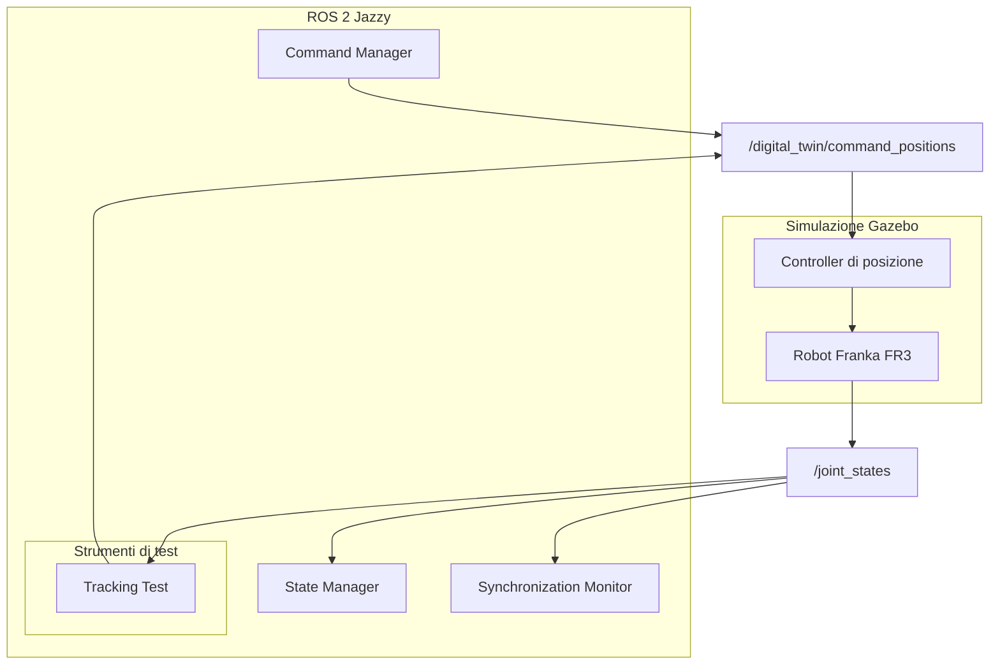

# Architettura del Digital Twin — Franka FR3

## 1. Introduzione

Il progetto ha l'obiettivo di realizzare un Digital Twin del robot Franka FR3 utilizzando ROS 2 Jazzy e Gazebo.

Il sistema mette in comunicazione il modello virtuale del robot e i componenti software che gestiscono lo stato e i comandi, con l'obiettivo di studiare il comportamento del Digital Twin e la sincronizzazione tra lo stato desiderato e quello effettivamente osservato nella simulazione.

L'architettura è organizzata in componenti distinti, ciascuno con una responsabilità specifica:

- **State Manager:** gestisce la rappresentazione dello stato del robot.
- **Command Manager:** gestisce l'invio dei comandi di posizione al robot simulato.
- **Synchronization Monitor:** monitora la sincronizzazione tra lo stato desiderato e quello osservato.
- **Tracking Test:** esegue test automatici per verificare il raggiungimento e il mantenimento delle posizioni articolari desiderate.
- **Gazebo:** esegue la simulazione del robot Franka FR3.

L'architettura è modulare, in modo da facilitare la verifica dei singoli componenti e l'introduzione di funzionalità aggiuntive.

## 2. Architettura generale

Il sistema si basa su ROS 2 per lo scambio di informazioni tra i nodi e su Gazebo per la simulazione del robot.

Il flusso principale è il seguente:

1. Il `Command Manager` riceve e gestisce i comandi di posizione desiderati.
2. I comandi vengono pubblicati sul topic ROS 2 `/digital_twin/command_positions`.
3. Il controller di posizione del robot riceve i comandi e controlla il movimento del Franka FR3 simulato.
4. Il robot simulato pubblica il proprio stato articolare attraverso il topic `/joint_states`.
5. Lo `State Manager` utilizza le informazioni articolari disponibili per aggiornare la rappresentazione dello stato del robot.
6. Il `Synchronization Monitor` utilizza le informazioni sullo stato desiderato e sullo stato osservato per monitorare la sincronizzazione.
7. Il `Tracking Test` può inviare variazioni di posizione controllate e verificare automaticamente la risposta del robot.

Il test automatico è uno strumento di verifica separato dai componenti principali del sistema: viene eseguito quando necessario e termina al completamento del test.

### 2.1 Diagramma architetturale



Il diagramma rappresenta le principali componenti logiche e i flussi di comunicazione previsti dall'architettura. Non rappresenta necessariamente tutti i dettagli interni dei nodi ROS 2 o del controller.

## 3. Componenti software

### 3.1 State Manager

Lo `State Manager` gestisce la rappresentazione dello stato del robot a partire dalle informazioni articolari ricevute da ROS 2.

Il topic principale utilizzato per acquisire lo stato del robot è:

- `/joint_states`

Le informazioni ricevute consentono di conoscere le posizioni articolari osservate durante la simulazione.

Lo stato osservato costituisce una delle informazioni necessarie per verificare il comportamento del Digital Twin e confrontare il comportamento effettivo del robot con quello desiderato.

### 3.2 Command Manager

Il `Command Manager` gestisce l'invio dei comandi di posizione al robot simulato.

Il topic utilizzato per la trasmissione dei comandi è:

- `/digital_twin/command_positions`

Attraverso questo meccanismo è possibile richiedere nuove posizioni articolari e osservare la risposta del robot.

Il componente mantiene separata la gestione dei comandi dalla logica di osservazione dello stato, favorendo la modularità dell'architettura.

### 3.3 Synchronization Monitor

Il `Synchronization Monitor` è dedicato al monitoraggio della sincronizzazione tra lo stato desiderato e lo stato osservato del robot.

Il monitoraggio si basa sulle informazioni disponibili relative alle posizioni articolari e permette di analizzare eventuali differenze tra il riferimento desiderato e il comportamento del robot simulato.

Questo componente è distinto dal `Tracking Test`: il primo è dedicato al monitoraggio della sincronizzazione, mentre il secondo esegue una procedura di test con obiettivi e criteri di completamento definiti.

### 3.4 Simulazione del Franka FR3

Gazebo esegue la simulazione del robot Franka FR3.

Il controller di posizione riceve i comandi articolari e determina il movimento del robot simulato. Le posizioni articolari osservate vengono rese disponibili tramite il topic `/joint_states`.

La simulazione consente di verificare il comportamento del sistema senza richiedere l'esecuzione degli esperimenti su un robot fisico.

### 3.5 Tracking Test

Il `Tracking Test` è uno strumento di test automatico che verifica la capacità del robot simulato di raggiungere determinate posizioni articolari e di mantenerle per un intervallo di tempo stabilito.

Il nodo è implementato nel file:

```text
franka_dt/franka_dt/tracking_test.py
```

Il relativo entry point è registrato in:

```text
franka_dt/setup.py
```

Il test viene eseguito tramite il comando:

```bash
ros2 run franka_dt tracking_test
```

Il nodo invia i comandi di posizione e osserva lo stato articolare ricevuto da `/joint_states`.

#### Obiettivi del test

Il test verifica che:

1. il robot riceva il comando di posizione desiderato;
2. le articolazioni selezionate raggiungano i rispettivi valori obiettivo;
3. l'errore rispetto al riferimento rientri nella tolleranza definita;
4. la condizione richiesta rimanga stabile per l'intervallo temporale configurato;
5. il test termini con esito positivo oppure segnali il mancato completamento entro il timeout.

Il test termina automaticamente al termine della procedura.

#### Parametri del test

La configurazione attualmente utilizzata è la seguente:

| Parametro | Valore | Descrizione |
|---|---:|---|
| Offset joint 2 | +0.03 rad | Variazione richiesta per la seconda articolazione |
| Offset joint 4 | +0.03 rad | Variazione richiesta per la quarta articolazione |
| Offset joint 7 | -0.03 rad | Variazione richiesta per la settima articolazione |
| Tolleranza | 0.01 rad | Errore massimo ammesso rispetto al riferimento |
| Tempo di stabilità | 0.5 s | Intervallo per cui la condizione di successo deve essere mantenuta |
| Timeout | 10 s | Tempo massimo previsto per il completamento del test |

Gli offset sono applicati alle articolazioni selezionate rispetto alle rispettive posizioni iniziali.

La tolleranza e il tempo di stabilità sono utilizzati congiuntamente: il test non considera sufficiente un semplice passaggio momentaneo entro la tolleranza, ma richiede che la condizione di successo venga mantenuta per l'intervallo configurato.

#### Risultati sperimentali

Sono state eseguite due prove del test automatico, entrambe concluse con esito positivo.

Durante la prima prova sono stati osservati i seguenti errori massimi:

| Articolazione | Errore massimo osservato |
|---|---:|
| Joint 2 | 0.020751 rad |
| Joint 4 | 0.016329 rad |
| Joint 7 | 0.009414 rad |

Il completamento stabile della condizione di successo è stato registrato dopo circa `0.601 s`.

In entrambe le prove il test ha rilevato il raggiungimento della condizione richiesta e si è concluso con esito positivo.

Gli errori massimi riportati sono valori osservati durante l'evoluzione del movimento: possono quindi superare la tolleranza finale senza implicare necessariamente il fallimento del test. L'esito positivo dipende dal soddisfacimento dei criteri di successo previsti dalla procedura, compreso il mantenimento della condizione richiesta per il tempo di stabilità configurato.

I valori finali stampati a sei cifre decimali come `0.000000` devono essere interpretati come valori arrotondati, non come prova di un errore matematicamente nullo.

I risultati delle prove vengono salvati in file CSV nella directory:

```text
results/
```

Questa directory è esclusa dal versionamento Git tramite `.gitignore`, perché contiene risultati sperimentali generati durante l'esecuzione.

## 4. Comunicazione ROS 2

La comunicazione tra i componenti avviene attraverso topic ROS 2.

### 4.1 Topic dei comandi

**Topic:**

```text
/digital_twin/command_positions
```

**Scopo:** trasmettere i comandi di posizione articolare verso il sistema di controllo del robot.

Il `Command Manager` utilizza questo topic per inviare i riferimenti desiderati. Il `Tracking Test` lo utilizza durante l'esecuzione delle prove automatiche.

### 4.2 Topic dello stato articolare

**Topic:**

```text
/joint_states
```

**Scopo:** rendere disponibili le informazioni sullo stato articolare osservato del robot.

Il topic viene utilizzato dai componenti che devono conoscere le posizioni articolari correnti, tra cui lo `State Manager`, il `Synchronization Monitor` e il `Tracking Test`.

### 4.3 Flusso delle informazioni

Il flusso principale di informazioni può essere riassunto come segue:

```text
Command Manager / Tracking Test
              |
              v
/digital_twin/command_positions
              |
              v
Controller di posizione
              |
              v
Robot Franka FR3 in Gazebo
              |
              v
        /joint_states
              |
      +-------+----------------+
      |       |                |
      v       v                v
 State     Synchronization   Tracking
 Manager   Monitor           Test
```

Il diagramma descrive il flusso logico delle informazioni. I collegamenti effettivi dipendono dai nodi e dai topic presenti nell'esecuzione corrente.

## 5. Test manuali già effettuati

Prima dell'introduzione del `Tracking Test` sono state effettuate prove manuali per verificare che i comandi di posizione producessero il movimento atteso del robot simulato.

I test manuali descritti in questa sezione sono distinti dalle prove automatiche documentate nella sezione 3.5.

### 5.1 Test 1 — Movimento della joint 7

È stato modificato il riferimento della settima articolazione, lasciando invariate le altre articolazioni.

| Grandezza | Valore |
|---|---:|
| Posizione iniziale joint 7 | 0.8209257324 rad |
| Posizione obiettivo joint 7 | 0.9209257324 rad |
| Variazione richiesta | +0.1 rad |
| Posizione finale joint 7 | 0.9209257324 rad |

**Risultato:** il valore finale osservato corrisponde al valore obiettivo riportato per la joint 7. Le altre articolazioni sono rimaste invariate.

### 5.2 Test 2 — Movimento simultaneo di tre articolazioni

È stato richiesto un movimento simultaneo delle joint 2, 4 e 7, mantenendo invariate le altre articolazioni.

| Articolazione | Posizione iniziale | Posizione obiettivo | Variazione |
|---|---:|---:|---:|
| Joint 2 | -0.7598819315 rad | -0.5598819315 rad | +0.20 rad |
| Joint 4 | -2.3306982713 rad | -2.1306982713 rad | +0.20 rad |
| Joint 7 | 0.9209257324 rad | 0.7209257324 rad | -0.20 rad |

**Risultato:** il test ha permesso di verificare l'invio simultaneo di comandi a più articolazioni.

Durante l'esecuzione è stato visualizzato il messaggio:

```text
A message was lost!!!
```

Nonostante l'avviso, è stato ottenuto un campione completo utilizzabile per la verifica del movimento.

L'avviso viene riportato come osservazione dell'esecuzione e non viene interpretato, da solo, come prova conclusiva di un malfunzionamento dell'intero sistema.

## 6. Decisioni progettuali

L'architettura è stata organizzata seguendo alcuni principi progettuali.

### 6.1 Separazione delle responsabilità

La gestione dei comandi, la rappresentazione dello stato e il monitoraggio della sincronizzazione sono assegnati a componenti distinti.

Questa scelta facilita la comprensione del sistema, la verifica dei singoli componenti e l'introduzione di nuove funzionalità.

### 6.2 Utilizzo di ROS 2

ROS 2 consente ai nodi di comunicare attraverso interfacce standardizzate, come i topic.

La separazione tra nodi permette di sviluppare e testare le funzionalità senza concentrare tutta la logica in un unico componente.

### 6.3 Utilizzo di Gazebo

Gazebo fornisce l'ambiente di simulazione necessario per osservare il comportamento del robot e verificare i comandi articolari.

L'utilizzo della simulazione permette di ripetere le prove e raccogliere dati senza dipendere dalla disponibilità di un robot fisico.

### 6.4 Test ripetibili

Il `Tracking Test` automatizza una procedura di verifica definita attraverso offset articolari, tolleranza, tempo di stabilità e timeout.

La registrazione dei risultati in CSV permette di conservare i dati sperimentali e di analizzarli successivamente.

I risultati dei test automatici devono essere considerati separatamente dalle osservazioni dei test manuali, poiché le due tipologie di prova utilizzano procedure e obiettivi differenti.

## 7. Stato attuale del progetto

Le funzionalità e le verifiche documentate in questa sezione rappresentano lo stato del progetto al momento dell'aggiornamento di questo documento.

| Componente o attività | Stato |
|---|---|
| Ambiente ROS 2 Jazzy | Configurato |
| Simulazione del Franka FR3 in Gazebo | Utilizzata per le prove |
| Command Manager | Presente nell'architettura |
| State Manager | Presente nell'architettura |
| Synchronization Monitor | Presente nell'architettura |
| Test manuale della joint 7 | Eseguito |
| Test manuale simultaneo di più articolazioni | Eseguito |
| Tracking Test automatico | Implementato |
| Due esecuzioni del Tracking Test | Completate con esito positivo |
| Salvataggio dei risultati del Tracking Test in CSV | Implementato |
| ODTE (Online Digital Twin Engine) | Da sviluppare |

La tabella distingue le funzionalità già verificate da quelle che costituiscono sviluppi futuri.

## 8. Sviluppi futuri

Le attività successive potranno concentrarsi sui seguenti aspetti.

### 8.1 Ripetizione dei test automatici

Eseguire un numero maggiore di prove per valutare la ripetibilità dei risultati e verificare il comportamento del sistema in condizioni differenti.

### 8.2 Analisi dei risultati sperimentali

Analizzare i file CSV generati dal `Tracking Test` per studiare l'evoluzione temporale delle posizioni articolari, gli errori rispetto ai riferimenti e i tempi necessari al raggiungimento della condizione di successo.

### 8.3 Approfondimento della sincronizzazione

Approfondire il confronto tra lo stato desiderato e quello osservato, verificando il comportamento del `Synchronization Monitor` e le informazioni disponibili per la valutazione della sincronizzazione.

### 8.4 Sviluppo dell'ODTE

L'Online Digital Twin Engine (ODTE) è una possibile estensione dell'architettura.

Il suo sviluppo potrà essere affrontato successivamente, definendo in modo esplicito le responsabilità, le interfacce e le modalità di integrazione con i componenti già presenti.

**Nota:** l'ODTE è attualmente un'attività futura e non deve essere considerato un componente già implementato.

## 9. Struttura dei risultati sperimentali

I risultati prodotti dai test automatici vengono salvati nella directory:

```text
results/
```

La directory contiene file CSV generati durante le esecuzioni. Poiché si tratta di risultati sperimentali, è esclusa dal versionamento Git.

La configurazione di `.gitignore` deve includere:

```gitignore
# Risultati dei test sperimentali
results/
```

Questa scelta permette di mantenere il repository concentrato sul codice sorgente, sulla documentazione e sui file necessari a riprodurre il progetto, senza aggiungere automaticamente tutti i risultati generati durante i test.

## 10. Conclusioni

L'architettura del Digital Twin del Franka FR3 è organizzata in componenti distinti per la gestione dei comandi, la rappresentazione dello stato e il monitoraggio della sincronizzazione.

Le prove manuali hanno permesso di verificare il comportamento dei comandi articolari, mentre il `Tracking Test` introduce una procedura automatica e ripetibile per valutare il raggiungimento e il mantenimento di posizioni desiderate.

Le prove automatiche effettuate si sono concluse con esito positivo e hanno prodotto risultati salvati in formato CSV.

I prossimi passi riguardano l'ampliamento della campagna di test, l'analisi quantitativa dei risultati e lo sviluppo delle funzionalità future, tra cui l'ODTE.
