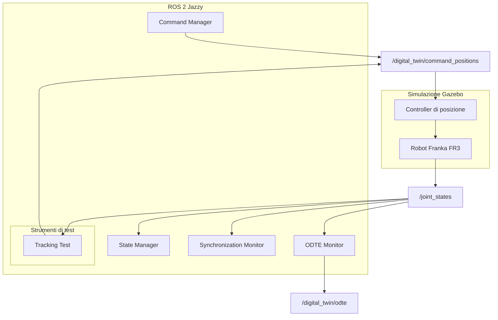

# Architettura del Digital Twin — Franka FR3

## 1. Introduzione

Il progetto ha l'obiettivo di realizzare un Digital Twin del robot Franka FR3 utilizzando ROS 2 Jazzy e Gazebo.

Il sistema mette in comunicazione il modello virtuale del robot e i componenti software che gestiscono lo stato e i comandi, con l'obiettivo di studiare il comportamento del Digital Twin e la sincronizzazione tra lo stato desiderato e quello effettivamente osservato nella simulazione.

L'architettura è organizzata in componenti distinti, ciascuno con una responsabilità specifica:

- **State Manager:** gestisce la rappresentazione dello stato del robot.
- **Command Manager:** gestisce l'invio dei comandi di posizione al robot simulato.
- **Synchronization Monitor:** monitora la freschezza degli aggiornamenti dello stato del robot.
- **Tracking Test:** esegue test automatici per verificare il raggiungimento e il mantenimento delle posizioni articolari desiderate.
- **Gazebo:** esegue la simulazione del robot Franka FR3.
- **ODTE Monitor:** analizza gli aggiornamenti ricevuti sul topic `/joint_states`, calcola una prima stima delle metriche Timeliness, Reliability e Availability e pubblica il risultato complessivo sul topic `/digital_twin/odte`.

L'ODTE Monitor costituisce attualmente un **prototipo sperimentale**. Le formule utilizzate, la gestione dei riferimenti temporali e il calcolo di alcune componenti della metrica sono ancora da verificare e perfezionare.

L'architettura è modulare, in modo da facilitare la verifica dei singoli componenti e l'introduzione di funzionalità aggiuntive.

---

## 2. Architettura generale

Il sistema si basa su ROS 2 per lo scambio di informazioni tra i nodi e su Gazebo per la simulazione del robot.

Il flusso principale è il seguente:

1. Il `Command Manager` riceve e gestisce i comandi di posizione desiderati.
2. I comandi vengono pubblicati sul topic ROS 2 `/digital_twin/command_positions`.
3. Il controller di posizione del robot riceve i comandi e controlla il movimento del Franka FR3 simulato.
4. Il robot simulato pubblica il proprio stato articolare attraverso il topic `/joint_states`.
5. Lo `State Manager` utilizza le informazioni articolari disponibili per aggiornare la rappresentazione dello stato del robot.
6. Il `Synchronization Monitor` controlla la freschezza degli aggiornamenti dello stato articolare.
7. Il `Tracking Test` può inviare variazioni di posizione controllate e verificare automaticamente la risposta del robot.
8. L'`ODTE Monitor` utilizza gli aggiornamenti ricevuti da `/joint_states` per calcolare una stima sperimentale delle metriche ODTE e pubblicarla su `/digital_twin/odte`.

Il test automatico è uno strumento di verifica separato dai componenti principali del sistema: viene eseguito quando necessario e termina al completamento del test.

### 2.1 Diagramma architetturale



Il diagramma rappresenta le principali componenti logiche e i flussi di comunicazione previsti dall'architettura. Non rappresenta necessariamente tutti i dettagli interni dei nodi ROS 2 o del controller.

Il `Tracking Test` è uno strumento di verifica eseguito separatamente quando necessario. L'`ODTE Monitor`, invece, è un nodo dedicato al monitoraggio sperimentale delle metriche e può essere avviato indipendentemente dagli altri nodi applicativi.

---

## 3. Componenti software

### 3.1 State Manager

Lo `State Manager` gestisce la rappresentazione dello stato del robot a partire dalle informazioni articolari ricevute da ROS 2.

Il topic principale utilizzato per acquisire lo stato del robot è:

- `/joint_states`

Il messaggio utilizzato è `sensor_msgs/msg/JointState`.

Le informazioni ricevute consentono di conoscere le posizioni articolari osservate durante la simulazione.

Lo stato osservato costituisce una delle informazioni necessarie per verificare il comportamento del Digital Twin e confrontare il comportamento effettivo del robot con quello desiderato.

Il nodo è implementato nel file:

```text
franka_dt/franka_dt/state_manager.py
```

### 3.2 Command Manager

Il `Command Manager` gestisce l'invio dei comandi di posizione al robot simulato.

Il topic utilizzato per la trasmissione dei comandi è:

- `/digital_twin/command_positions`

Il nodo riceve messaggi di tipo `std_msgs/msg/Float64MultiArray` e inoltra i comandi validi al controller attraverso:

- `/fr3_position_controller/commands`

Le principali responsabilità sono:

- Ricevere i comandi di posizione desiderati.
- Verificare che ogni comando contenga esattamente sette valori.
- Controllare che i valori siano finiti.
- Inoltrare i comandi validi al controller del robot.

Il componente mantiene separata la gestione dei comandi dalla logica di osservazione dello stato, favorendo la modularità dell'architettura.

Il nodo è implementato nel file:

```text
franka_dt/franka_dt/command_manager.py
```

### 3.3 Synchronization Monitor

Il `Synchronization Monitor` è dedicato al monitoraggio della freschezza degli aggiornamenti dello stato articolare del robot.

Il monitor utilizza il topic:

- `/joint_states`

La soglia attualmente utilizzata per identificare aggiornamenti non sufficientemente recenti è di **2 secondi**.

Le principali responsabilità sono:

- Monitorare la ricezione degli aggiornamenti.
- Verificare se lo stato del robot è ancora aggiornato.
- Rilevare le transizioni tra uno stato aggiornato e uno non aggiornato.
- Segnalare eventuali interruzioni nella ricezione dei dati.

Questo componente è distinto dal `Tracking Test`: il monitor controlla la freschezza degli aggiornamenti, mentre il test esegue una procedura con obiettivi e criteri di completamento definiti.

È importante distinguere il monitoraggio della freschezza dei dati dalla verifica completa della sincronizzazione tra un sistema fisico e il suo Digital Twin. La soglia temporale permette di individuare interruzioni o ritardi significativi, ma da sola non dimostra che il modello digitale riproduca perfettamente lo stato del sistema rappresentato.

Il nodo è implementato nel file:

```text
franka_dt/franka_dt/synchronization_monitor.py
```

### 3.4 Simulazione del Franka FR3

Gazebo esegue la simulazione del robot Franka FR3.

Il controller di posizione riceve i comandi articolari e determina il movimento del robot simulato. Le posizioni articolari osservate vengono rese disponibili tramite il topic `/joint_states`.

La simulazione consente di verificare il comportamento del sistema senza richiedere l'esecuzione degli esperimenti su un robot fisico.

Il comando utilizzato per avviare la simulazione è:

```bash
source /opt/ros/jazzy/setup.bash
source ~/franka_ros2_ws/install/setup.bash

ros2 launch franka_gazebo_bringup gazebo_franka_arm_example_controller.launch.py load_gripper:=true franka_hand:=franka_hand controller:=fr3_position_controller
```

Il comando avvia il modello simulato del Franka FR3 con la configurazione del controller di posizione utilizzata nel progetto.

### 3.5 Tracking Test

Il `Tracking Test` è uno strumento di test automatico che verifica la capacità del robot simulato di raggiungere determinate posizioni articolari e di mantenerle per un intervallo di tempo stabilito.

Il nodo è implementato nel file:

```text
franka_dt/franka_dt/tracking_test.py
```

Il relativo entry point è registrato in:

```text
franka_dt/setup.py
```

Il test viene eseguito tramite il comando:

```bash
ros2 run franka_dt tracking_test
```

Il nodo invia i comandi di posizione e osserva lo stato articolare ricevuto da `/joint_states`.

#### Obiettivi del test

Il test verifica che:

1. Il robot riceva il comando di posizione desiderato.
2. Le articolazioni selezionate raggiungano i rispettivi valori obiettivo.
3. L'errore rispetto al riferimento rientri nella tolleranza definita.
4. La condizione richiesta rimanga stabile per l'intervallo temporale configurato.
5. Il test termini con esito positivo oppure segnali il mancato completamento entro il timeout.

Il test termina automaticamente al termine della procedura.

#### Parametri del test

La configurazione attualmente utilizzata è la seguente:

| Parametro | Valore | Descrizione |
|---|---:|---|
| Offset joint 2 | +0.03 rad | Variazione richiesta per la seconda articolazione |
| Offset joint 4 | +0.03 rad | Variazione richiesta per la quarta articolazione |
| Offset joint 7 | -0.03 rad | Variazione richiesta per la settima articolazione |
| Tolleranza | 0.01 rad | Errore massimo ammesso rispetto al riferimento durante la verifica |
| Tempo di stabilità | 0.5 s | Intervallo per cui la condizione di successo deve essere mantenuta |
| Timeout | 10 s | Tempo massimo previsto per il completamento del test |

Gli offset sono applicati alle articolazioni selezionate rispetto alle rispettive posizioni iniziali.

La tolleranza e il tempo di stabilità sono utilizzati congiuntamente: il test non considera sufficiente un semplice passaggio momentaneo entro la tolleranza, ma richiede che la condizione di successo venga mantenuta per l'intervallo configurato.

#### Risultati sperimentali

Sono state eseguite due prove del test automatico, entrambe concluse con esito positivo.

Durante una delle prove sono stati osservati i seguenti errori massimi:

| Articolazione | Errore massimo osservato |
|---|---:|
| Joint 2 | 0.020751 rad |
| Joint 4 | 0.016329 rad |
| Joint 7 | 0.009414 rad |

Il completamento stabile della condizione di successo è stato registrato dopo circa `0.601 s`.

In entrambe le prove il test ha rilevato il raggiungimento della condizione richiesta e si è concluso con esito positivo.

Gli errori massimi riportati sono valori osservati durante l'evoluzione del movimento: possono quindi superare la tolleranza finale senza implicare necessariamente il fallimento del test. L'esito positivo dipende dal soddisfacimento dei criteri di successo previsti dalla procedura, compreso il mantenimento della condizione richiesta per il tempo di stabilità configurato.

In una delle esecuzioni, gli errori assoluti finali sono stati stampati come `0.000000 rad` per tutte e tre le articolazioni. Questi valori devono essere interpretati come risultati arrotondati a sei cifre decimali, non come prova di un errore matematicamente nullo.

I risultati delle prove vengono salvati in file CSV nella directory:

```text
results/
```

Questa directory è esclusa dal versionamento Git tramite `.gitignore`, perché contiene risultati sperimentali generati durante l'esecuzione.

### 3.6 ODTE Monitor

L'`ODTE Monitor` è un nodo ROS 2 che implementa un primo prototipo sperimentale per il calcolo della metrica **ODTE (Overall Digital Twin Entanglement)**.

L'obiettivo è analizzare gli aggiornamenti dello stato del robot e produrre una stima di alcune proprietà temporali e operative del flusso di informazioni dal sistema fisico alla sua rappresentazione digitale.

Il nodo è implementato nel file:

```text
franka_dt/franka_dt/odte_monitor.py
```

#### Funzionamento

L'ODTE Monitor:

1. Si sottoscrive al topic `/joint_states`.
2. Verifica la presenza delle sette articolazioni richieste.
3. Controlla che le posizioni ricevute siano valori finiti.
4. Elabora le informazioni temporali disponibili.
5. Calcola una stima delle componenti Timeliness, Reliability e Availability.
6. Combina le componenti per ottenere un valore ODTE.
7. Pubblica il risultato in formato JSON sul topic `/digital_twin/odte`.

Il nodo utilizza il tipo di messaggio ROS 2 `std_msgs/msg/String` per pubblicare i dati JSON.

#### Topic utilizzato

Il topic di output è:

```text
/digital_twin/odte
```

Il messaggio contiene informazioni relative alla direzione del flusso e ai valori delle metriche calcolate.

Un esempio della struttura del messaggio è:

```json
{
  "direction": "physical_to_digital",
  "timeliness": 1.0,
  "reliability": 1.0,
  "availability": 1.0,
  "odte": 1.0
}
```

L'esempio illustra la struttura dei dati pubblicati e non rappresenta una validazione scientifica della metrica.

#### Parametri di configurazione

Il nodo viene avviato con il seguente comando:

```bash
ros2 run franka_dt odte_monitor --ros-args -p use_sim_time:=true -p expected_rate_hz:=100.0 -p desired_timeliness_ms:=50.0 -p window_seconds:=10.0
```

I parametri utilizzati sono:

| Parametro | Valore | Descrizione |
|---|---:|---|
| `use_sim_time` | `true` | Utilizza il tempo di simulazione ROS |
| `expected_rate_hz` | `100.0` | Frequenza di aggiornamento attesa |
| `desired_timeliness_ms` | `50.0` | Soglia temporale desiderata, espressa in millisecondi |
| `window_seconds` | `10.0` | Finestra temporale utilizzata per il monitoraggio |

L'utilizzo di `use_sim_time:=true` consente al nodo di utilizzare il tempo di simulazione ROS, che deve essere coerente con i riferimenti temporali utilizzati per l'elaborazione.

Per visualizzare i risultati pubblicati:

```bash
ros2 topic echo /digital_twin/odte
```

#### Precisazioni sulle metriche

La versione attuale è un prototipo sperimentale. Il fatto che il nodo riceva i dati, esegua i calcoli e pubblichi i risultati dimostra il funzionamento del flusso software, ma non dimostra che la metrica sia stata implementata in modo scientificamente equivalente alla formulazione originale.

Le componenti attualmente utilizzate presentano le seguenti limitazioni.

**Timeliness (T)**

La tempestività viene stimata utilizzando le informazioni temporali disponibili, confrontando il timestamp del messaggio con il riferimento temporale utilizzato dal monitor e considerando la soglia configurata.

La correttezza di questa stima dipende dalla coerenza dei timestamp, dalla gestione del tempo di simulazione e dalla corretta definizione dell'istante di riferimento.

Il calcolo deve essere ulteriormente verificato rispetto alla formulazione matematica originale della metrica.

**Reliability (R)**

L'affidabilità viene stimata in funzione della frequenza di aggiornamento osservata rispetto alla frequenza attesa, con il valore limitato a un massimo pari a 1.

Il valore può risultare basso durante l'avvio o quando sono disponibili pochi aggiornamenti. La stima dipende quindi dalla finestra temporale utilizzata e dalla frequenza effettivamente osservata.

**Availability (A)**

Nella versione attuale, la disponibilità è impostata a 1.

Di conseguenza, il valore non rappresenta ancora una misura indipendente della disponibilità effettiva del sistema. Questa scelta deve essere documentata e verificata rispetto alla definizione della metrica di riferimento.

**Execution time**

Il tempo di esecuzione non è ancora misurato in modo adeguato per rappresentare il tempo necessario a completare l'elaborazione di un aggiornamento del Digital Twin.

La misurazione deve essere rivista per includere l'effettivo intervallo di elaborazione, anziché basarsi su letture temporali effettuate quasi consecutivamente.

**Valore complessivo ODTE**

Il valore ODTE viene calcolato combinando le componenti attualmente implementate.

Il risultato deve essere interpretato tenendo conto delle limitazioni delle singole componenti. Un valore `ODTE = 1.0` non dimostra, da solo, una sincronizzazione perfetta tra il sistema fisico e il Digital Twin.

Per ottenere una misura scientificamente più rigorosa sarà necessario verificare la formulazione originale, definire con precisione i riferimenti temporali, misurare il tempo di elaborazione effettivo e validare separatamente ciascuna componente.

#### Risultati preliminari

Durante le prove del nodo sono stati osservati messaggi di questo tipo:

```text
[INFO] ODTE Monitor avviato: percorso Physical -> Digital.
[WARN] ODTE non ancora calcolabile: servono almeno due aggiornamenti validi.
[INFO] T=1.000 | R=0.006 | A=1.000 | ODTE=0.006
[INFO] T=1.000 | R=1.000 | A=1.000 | ODTE=1.000
```

Il primo avviso indica che, all'avvio, il monitor necessita di almeno due aggiornamenti validi prima di poter effettuare il calcolo.

Successivamente, il nodo ha iniziato a pubblicare messaggi JSON sul topic `/digital_twin/odte`.

I risultati mostrano che il flusso di ricezione, elaborazione e pubblicazione è operativo negli scenari provati. Non costituiscono, tuttavia, una validazione quantitativa della qualità della sincronizzazione.

#### Sviluppi previsti per ODTE

Le attività successive comprendono:

- Verificare la formulazione matematica originale della metrica.
- Definire in modo rigoroso i riferimenti temporali utilizzati per il calcolo.
- Migliorare la stima della Timeliness.
- Verificare la definizione e il calcolo della Reliability.
- Definire una misura adeguata della Availability.
- Misurare il tempo effettivo di elaborazione del Digital Twin.
- Confrontare i risultati ottenuti in condizioni operative differenti.
- Documentare i limiti sperimentali e le condizioni in cui i risultati sono validi.

L'ODTE Monitor deve quindi essere considerato una componente implementata in fase sperimentale, ancora da perfezionare e validare.

---

## 4. Comunicazione ROS 2

La comunicazione tra i componenti avviene attraverso topic ROS 2.

### 4.1 Topic dei comandi

**Topic:**

```text
/digital_twin/command_positions
```

**Tipo di messaggio:**

```text
std_msgs/msg/Float64MultiArray
```

**Scopo:** trasmettere i comandi di posizione articolare verso il sistema di controllo del robot.

Il `Command Manager` utilizza questo topic per inviare i riferimenti desiderati. Il `Tracking Test` lo utilizza durante l'esecuzione delle prove automatiche.

### 4.2 Topic del controller

**Topic:**

```text
/fr3_position_controller/commands
```

**Tipo di messaggio:**

```text
std_msgs/msg/Float64MultiArray
```

**Scopo:** trasmettere i comandi di posizione al controller del robot.

Il `Command Manager` inoltra a questo topic i comandi che hanno superato i controlli di validità previsti.

### 4.3 Topic dello stato articolare

**Topic:**

```text
/joint_states
```

**Tipo di messaggio:**

```text
sensor_msgs/msg/JointState
```

**Scopo:** rendere disponibili le informazioni sullo stato articolare osservato del robot.

Il topic viene utilizzato dai componenti che devono conoscere le posizioni articolari correnti, tra cui:

- `State Manager`
- `Synchronization Monitor`
- `Tracking Test`
- `ODTE Monitor`

### 4.4 Topic delle metriche ODTE

**Topic:**

```text
/digital_twin/odte
```

**Tipo di messaggio:**

```text
std_msgs/msg/String
```

**Scopo:** pubblicare le metriche ODTE calcolate dal monitor in formato JSON.

Il topic permette di osservare i risultati del prototipo sperimentale senza modificare il flusso di comando del robot.

### 4.5 Riepilogo dei topic

| Topic | Tipo di messaggio | Funzione |
|---|---|---|
| `/digital_twin/command_positions` | `std_msgs/msg/Float64MultiArray` | Ricezione dei comandi di posizione desiderati |
| `/fr3_position_controller/commands` | `std_msgs/msg/Float64MultiArray` | Invio dei comandi al controller |
| `/joint_states` | `sensor_msgs/msg/JointState` | Pubblicazione dello stato articolare osservato |
| `/digital_twin/odte` | `std_msgs/msg/String` | Pubblicazione delle metriche ODTE in formato JSON |

### 4.6 Flusso delle informazioni

Il flusso principale delle informazioni può essere riassunto come segue:

```text
Command Manager / Tracking Test
              |
              v
/digital_twin/command_positions
              |
              v
/fr3_position_controller/commands
              |
              v
Controller di posizione
              |
              v
Robot Franka FR3 in Gazebo
              |
              v
         /joint_states
              |
       +------+------+----------------+
       |             |                |
       v             v                v
  State Manager  Synchronization   Tracking
                 Monitor           Test
                       |
                       |
                 ODTE Monitor
                       |
                       v
                /digital_twin/odte
```

Il diagramma descrive il flusso logico delle informazioni. I collegamenti effettivi dipendono dai nodi e dai topic presenti nell'esecuzione corrente.

---

## 5. Test manuali già effettuati

Prima e durante lo sviluppo del `Tracking Test` sono state effettuate prove manuali per verificare che i comandi di posizione producessero il movimento atteso del robot simulato.

I test manuali descritti in questa sezione sono distinti dalle prove automatiche documentate nella sezione 3.5.

### 5.1 Test 1 — Movimento della joint 7

È stato modificato il riferimento della settima articolazione, lasciando invariate le altre articolazioni.

| Grandezza | Valore |
|---|---:|
| Posizione iniziale joint 7 | 0.8209257324 rad |
| Posizione obiettivo joint 7 | 0.9209257324 rad |
| Variazione richiesta | +0.1 rad |
| Posizione finale joint 7 | 0.9209257324 rad |

**Risultato:** il valore finale osservato corrisponde al valore obiettivo riportato per la joint 7. Le altre articolazioni sono rimaste invariate.

### 5.2 Test 2 — Movimento simultaneo di tre articolazioni

È stato richiesto un movimento simultaneo delle joint 2, 4 e 7, mantenendo invariate le altre articolazioni.

| Articolazione | Posizione iniziale | Posizione obiettivo | Variazione |
|---|---:|---:|---:|
| Joint 2 | -0.7598819315 rad | -0.5598819315 rad | +0.20 rad |
| Joint 4 | -2.3306982713 rad | -2.1306982713 rad | +0.20 rad |
| Joint 7 | 0.9209257324 rad | 0.7209257324 rad | -0.20 rad |

**Risultato:** il test ha permesso di verificare l'invio simultaneo di comandi a più articolazioni.

Durante l'esecuzione è stato visualizzato il messaggio:

```text
A message was lost!!!
```

Nonostante l'avviso, è stato ottenuto un campione completo utilizzabile per la verifica del movimento.

L'avviso viene riportato come osservazione dell'esecuzione e non viene interpretato, da solo, come prova conclusiva di un malfunzionamento dell'intero sistema.

---

## 6. Decisioni progettuali

L'architettura è stata organizzata seguendo alcuni principi progettuali.

### 6.1 Separazione delle responsabilità

La gestione dei comandi, la rappresentazione dello stato e il monitoraggio della freschezza degli aggiornamenti sono assegnati a componenti distinti.

Il `Tracking Test` e l'`ODTE Monitor` sono anch'essi separati dai nodi che gestiscono il flusso principale dei comandi.

Questa scelta facilita la comprensione del sistema, la verifica dei singoli componenti e l'introduzione di nuove funzionalità.

### 6.2 Utilizzo di ROS 2

ROS 2 consente ai nodi di comunicare attraverso interfacce standardizzate, come i topic.

La separazione tra nodi permette di sviluppare e testare le funzionalità senza concentrare tutta la logica in un unico componente.

L'utilizzo di topic distinti consente inoltre di separare i comandi di posizione dallo stato articolare osservato e dalle metriche sperimentali.

### 6.3 Utilizzo di Gazebo

Gazebo fornisce l'ambiente di simulazione necessario per osservare il comportamento del robot e verificare i comandi articolari.

L'utilizzo della simulazione permette di ripetere le prove e raccogliere dati senza dipendere dalla disponibilità di un robot fisico.

### 6.4 Test ripetibili

Il `Tracking Test` automatizza una procedura di verifica definita attraverso offset articolari, tolleranza, tempo di stabilità e timeout.

La registrazione dei risultati in CSV permette di conservare i dati sperimentali e di analizzarli successivamente.

I risultati dei test automatici devono essere considerati separatamente dalle osservazioni dei test manuali, poiché le due tipologie di prova utilizzano procedure e obiettivi differenti.

### 6.5 Monitoraggio sperimentale dell'ODTE

L'ODTE Monitor è stato introdotto come componente separato per esplorare il calcolo di metriche relative al flusso di informazioni dal sistema fisico alla rappresentazione digitale.

La separazione dal `State Manager` e dal `Command Manager` permette di sperimentare le metriche senza modificare direttamente la logica di acquisizione e di invio dei comandi.

La versione attuale non è ancora validata scientificamente. Le formule e le modalità di misurazione devono essere verificate prima di utilizzare i valori ottenuti per formulare conclusioni sulla qualità della sincronizzazione.

---

## 7. Stato attuale del progetto

Le funzionalità e le verifiche documentate in questa sezione rappresentano lo stato del progetto al momento dell'aggiornamento di questo documento.

| Componente o attività | Stato |
|---|---|
| Ambiente ROS 2 Jazzy | Configurato |
| Simulazione del Franka FR3 in Gazebo | Utilizzata per le prove |
| Command Manager | Implementato |
| State Manager | Implementato |
| Synchronization Monitor | Implementato |
| Test manuale della joint 7 | Eseguito |
| Test manuale simultaneo di più articolazioni | Eseguito |
| Tracking Test automatico | Implementato |
| Due esecuzioni del Tracking Test | Completate con esito positivo |
| Salvataggio dei risultati del Tracking Test in CSV | Implementato |
| ODTE Monitor | Implementato come prototipo sperimentale |
| Pubblicazione delle metriche su `/digital_twin/odte` | Verificata nelle prove preliminari |
| Validazione scientifica della metrica ODTE | Da completare |

La tabella distingue le funzionalità implementate da quelle che richiedono ulteriori verifiche.

In particolare, l'ODTE Monitor è già presente nel progetto e pubblica i risultati sul relativo topic, ma il calcolo delle metriche deve essere ulteriormente sviluppato e validato.

---

## 8. Sviluppi futuri

Le attività successive potranno concentrarsi sui seguenti aspetti.

### 8.1 Ripetizione dei test automatici

Eseguire un numero maggiore di prove per valutare la ripetibilità dei risultati e verificare il comportamento del sistema in condizioni differenti.

### 8.2 Analisi dei risultati sperimentali

Analizzare i file CSV generati dal `Tracking Test` per studiare l'evoluzione temporale delle posizioni articolari, gli errori rispetto ai riferimenti e i tempi necessari al raggiungimento della condizione di successo.

### 8.3 Approfondimento della sincronizzazione

Approfondire il confronto tra lo stato desiderato e quello osservato, verificando il comportamento del `Synchronization Monitor` e le informazioni disponibili per la valutazione della sincronizzazione.

### 8.4 Perfezionamento dell'ODTE

Le attività previste per l'ODTE comprendono:

- Verificare la formulazione matematica originale della metrica.
- Definire con precisione i riferimenti temporali utilizzati per il calcolo.
- Migliorare la stima della Timeliness.
- Verificare la definizione e il calcolo della Reliability.
- Definire una misura adeguata della Availability.
- Misurare il tempo effettivo di elaborazione del Digital Twin.
- Confrontare i risultati ottenuti in condizioni operative differenti.
- Documentare i limiti sperimentali e le condizioni in cui i risultati sono validi.

L'obiettivo è ottenere una valutazione più rigorosa delle metriche e stabilire in quali condizioni possano essere utilizzate per analizzare il comportamento del Digital Twin.

---

## 9. Struttura dei risultati sperimentali

I risultati prodotti dai test automatici vengono salvati nella directory:

```text
results/
```

La directory contiene file CSV generati durante le esecuzioni.

Poiché si tratta di risultati sperimentali, è esclusa dal versionamento Git.

La configurazione di `.gitignore` deve includere:

```gitignore
# Risultati dei test sperimentali
results/
```

Questa scelta permette di mantenere il repository concentrato sul codice sorgente, sulla documentazione e sui file necessari a riprodurre il progetto, senza aggiungere automaticamente tutti i risultati generati durante i test.

---

## 10. Controllo di versione

Il progetto utilizza **Git** per il controllo di versione e **GitHub** per ospitare il repository e condividere il codice sorgente.

---

## 11. Conclusioni

L'architettura del Digital Twin del Franka FR3 è organizzata in componenti distinti per la gestione dei comandi, la rappresentazione dello stato, il monitoraggio della freschezza degli aggiornamenti e la verifica del comportamento del robot simulato.

Le prove manuali hanno permesso di verificare il comportamento dei comandi articolari, mentre il `Tracking Test` introduce una procedura automatica e ripetibile per valutare il raggiungimento e il mantenimento di posizioni desiderate.

Le prove automatiche effettuate si sono concluse con esito positivo e hanno prodotto risultati salvati in formato CSV.

L'ODTE Monitor rappresenta un'estensione sperimentale dell'architettura: il nodo è stato implementato e la pubblicazione delle metriche è stata verificata nelle prove preliminari, ma la formulazione e il calcolo delle metriche richiedono ancora ulteriori verifiche e validazioni.

I prossimi passi riguardano l'ampliamento della campagna di test, l'analisi quantitativa dei risultati e il perfezionamento delle metriche ODTE, con l'obiettivo di ottenere una valutazione più rigorosa del comportamento e della sincronizzazione del Digital Twin.
