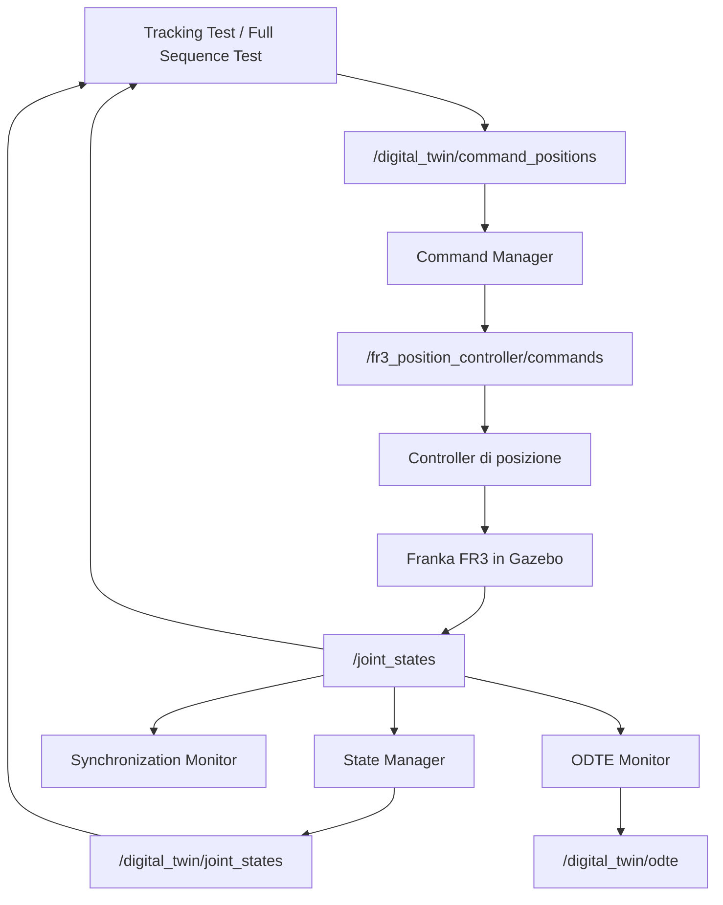

# Architettura del Digital Twin — Franka FR3

## 1. Panoramica

Il progetto realizza un Digital Twin del robot Franka FR3 in ambiente ROS 2 Jazzy e Gazebo.

L'architettura separa la gestione dei comandi, l'acquisizione dello stato articolare e il monitoraggio del sistema in componenti indipendenti.

I componenti principali sono:

- **Command Manager:** valida e inoltra i comandi di posizione.
- **State Manager:** acquisisce, valida e pubblica lo stato articolare del robot.
- **Synchronization Monitor:** controlla la freschezza degli aggiornamenti.
- **Tracking Test e Full Sequence Test:** verificano il raggiungimento delle posizioni desiderate e l'allineamento dello stato.
- **ODTE Monitor:** prototipo sperimentale per il calcolo di metriche relative al flusso di informazioni del Digital Twin.
- **Gazebo:** simula il robot e il relativo controller di posizione.

---

## 2. Architettura generale



Il flusso dei comandi raggiunge il controller del robot simulato. Lo stato osservato viene pubblicato su `/joint_states` e utilizzato dai nodi di monitoraggio e verifica.

Lo `State Manager` pubblica una rappresentazione filtrata dello stato su `/digital_twin/joint_states`, che può essere confrontata con lo stato originale durante i test.

---

## 3. Componenti principali

| Componente | Responsabilità |
|---|---|
| `command_manager.py` | Valida i comandi articolari e li inoltra al controller |
| `state_manager.py` | Valida lo stato ricevuto e pubblica i sette giunti del FR3 in un ordine definito |
| `synchronization_monitor.py` | Segnala l'assenza di aggiornamenti recenti, usando una soglia di 2 secondi |
| `tracking_test.py` | Verifica il raggiungimento e la stabilità delle posizioni di alcuni giunti |
| `full_sequence_test.py` | Verifica una sequenza di tre movimenti su tutti e sette i giunti e confronta lo stato del robot con quello del Digital Twin |
| `odte_monitor.py` | Calcola e pubblica una stima sperimentale delle metriche ODTE |

Il `Synchronization Monitor` verifica la freschezza degli aggiornamenti ricevuti, ma non misura da solo l'errore tra il robot e il Digital Twin.

L'`ODTE Monitor` è sperimentale: le formule e le misure temporali richiedono ulteriori verifiche e validazione.

---

## 4. Interfacce ROS 2

| Topic | Tipo di messaggio | Funzione |
|---|---|---|
| `/digital_twin/command_positions` | `std_msgs/msg/Float64MultiArray` | Ricezione dei comandi di posizione |
| `/fr3_position_controller/commands` | `std_msgs/msg/Float64MultiArray` | Invio dei comandi al controller |
| `/joint_states` | `sensor_msgs/msg/JointState` | Stato articolare osservato del robot |
| `/digital_twin/joint_states` | `sensor_msgs/msg/JointState` | Stato articolare validato e pubblicato dal Digital Twin |
| `/digital_twin/odte` | `std_msgs/msg/String` | Metriche ODTE in formato JSON |

Il `Command Manager` accetta comandi composti da sette valori finiti, corrispondenti alle articolazioni del braccio FR3.

---

## 5. Organizzazione del software

I componenti applicativi sono contenuti nel package `franka_dt`:

```text
franka_digital_twin/
├── docs/
│   └── architecture.md
├── franka_dt/
│   └── franka_dt/
│       ├── command_manager.py
│       ├── state_manager.py
│       ├── synchronization_monitor.py
│       ├── tracking_test.py
│       ├── full_sequence_test.py
│       └── odte_monitor.py
└── results/
```

La directory `results/` contiene i risultati CSV generati localmente dai test ed è esclusa dal versionamento Git tramite `.gitignore`.

---

## 6. Stato e limiti attuali

- La gestione dei comandi e l'acquisizione dello stato sono implementate.
- Lo stato articolare filtrato è pubblicato su `/digital_twin/joint_states`.
- I test automatici verificano il raggiungimento degli obiettivi e, nel test completo, l'allineamento tra lo stato del robot e quello del Digital Twin.
- Il monitor di sincronizzazione controlla la freschezza degli aggiornamenti.
- Il calcolo ODTE è ancora sperimentale: in particolare, la disponibilità è impostata a `1` e le misure temporali richiedono ulteriori verifiche.

Gli sviluppi successivi riguardano il rafforzamento dei test, la valutazione quantitativa della sincronizzazione e la validazione delle metriche ODTE.
