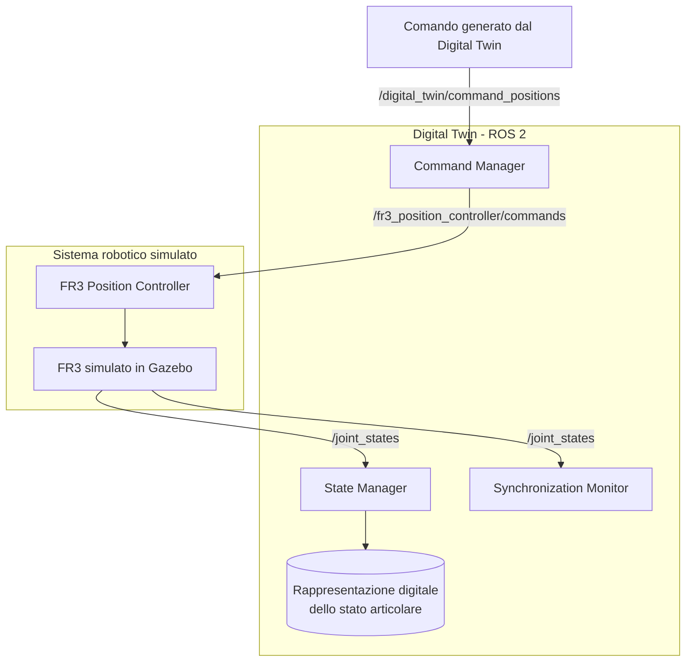

# Architettura del Digital Twin FR3

## 1. Introduzione

Il progetto prevede la progettazione e lo sviluppo di un Digital Twin bidirezionale del braccio robotico Franka Emika FR3, simulato mediante ROS 2 Jazzy e Gazebo.

L'architettura è organizzata in componenti software distinti, ciascuno responsabile di una specifica funzionalità.

Il sistema gestisce due percorsi principali:

- **Percorso dello stato:** acquisizione degli stati articolari del robot simulato e aggiornamento della rappresentazione digitale.
- **Percorso dei comandi:** invio di comandi di posizione dal Digital Twin al robot simulato.

Un ulteriore componente monitora la regolarità della ricezione degli stati articolari.

Il sistema viene sviluppato e valutato in ambiente simulato. Non è prevista, allo stato attuale, una validazione su un robot fisico reale.

## 2. Diagramma dell'architettura

Il diagramma rappresenta i principali collegamenti logici tra i componenti del sistema.

La rappresentazione digitale è lo stato mantenuto dallo State Manager e non costituisce, al momento, un nodo ROS 2 autonomo.

## 3. Componenti software

### 3.1 State Manager

Lo State Manager acquisisce gli stati articolari pubblicati sul topic `/joint_states`.

Le sue responsabilità sono:

- identificare i sette giunti del braccio FR3;
- acquisire la posizione e la velocità articolare, quando disponibile;
- aggiornare la rappresentazione digitale dello stato del robot;
- conservare il timestamp del messaggio sorgente;
- registrare il tempo di ricezione del messaggio;
- stampare periodicamente lo stato digitale.

Il componente costituisce il punto di ingresso delle informazioni provenienti dal robot simulato verso la rappresentazione digitale.

### 3.2 Command Manager

Il Command Manager gestisce il percorso di invio dei comandi di posizione dal Digital Twin al robot simulato.

Le sue responsabilità sono:

- ricevere i comandi dal topic `/digital_twin/command_positions`;
- verificare che siano presenti esattamente sette valori;
- rifiutare i comandi contenenti valori non finiti;
- inoltrare i comandi validi al controller di posizione;
- registrare nei log le posizioni obiettivo dei giunti.

Il comando viene inoltrato attraverso il topic `/fr3_position_controller/commands`.

Il controller utilizzato è `fr3_position_controller`.

### 3.3 Synchronization Monitor

Il Synchronization Monitor controlla la regolarità della ricezione degli stati articolari pubblicati su `/joint_states`.

Il componente:

- verifica la presenza dei sette giunti richiesti;
- registra il tempo di ricezione dei messaggi validi;
- controlla l'età dell'ultimo aggiornamento ricevuto;
- segnala il passaggio allo stato non sincronizzato;
- rileva il ripristino della ricezione regolare;
- evita di ripetere continuamente lo stesso avviso mentre una condizione persiste.

La soglia di obsolescenza dei dati è attualmente impostata a 2 secondi.

Il monitor fornisce un controllo preliminare della freschezza dei dati. Non costituisce un'implementazione completa della metrica ODTE.

### 3.4 Monitor ODTE

Il componente dedicato alla valutazione quantitativa dell'entanglement mediante ODTE non è ancora implementato.

La sua progettazione dovrà basarsi sulla definizione e sul metodo di calcolo riportati nella pubblicazione scientifica di riferimento.

Prima dell'implementazione sarà necessario definire le informazioni temporali e le misure richieste dalla metrica.

## 4. Comunicazione tra i componenti

I principali topic ROS 2 utilizzati sono:

| Topic | Tipo di messaggio | Funzione |
|---|---|---|
| `/joint_states` | `sensor_msgs/msg/JointState` | Distribuzione degli stati articolari |
| `/digital_twin/command_positions` | `std_msgs/msg/Float64MultiArray` | Ricezione dei comandi di posizione |
| `/fr3_position_controller/commands` | `std_msgs/msg/Float64MultiArray` | Invio dei comandi al controller |

### 4.1 Percorso dello stato

Il percorso di acquisizione dello stato è:

1. Il FR3 simulato produce gli stati articolari.
2. Gli stati vengono pubblicati sul topic `/joint_states`.
3. Lo State Manager acquisisce i messaggi e aggiorna la rappresentazione digitale.
4. Il Synchronization Monitor riceve gli stessi messaggi e controlla la regolarità degli aggiornamenti.

Lo State Manager e il Synchronization Monitor ricevono i dati indipendentemente l'uno dall'altro.

### 4.2 Percorso dei comandi

Il percorso di invio dei comandi è:

1. Il Digital Twin genera un comando di posizione.
2. Il comando viene pubblicato su `/digital_twin/command_positions`.
3. Il Command Manager riceve e valida il comando.
4. Il comando valido viene inoltrato a `/fr3_position_controller/commands`.
5. Il controller di posizione agisce sul FR3 simulato.
6. Le variazioni dello stato articolare possono essere osservate attraverso `/joint_states`.

Il ritorno dello stato articolare consente di verificare il risultato del comando nell'ambiente simulato.

## 5. Decisioni progettuali

### 5.1 Separazione delle responsabilità

L'architettura suddivide le funzionalità in tre componenti:

- acquisizione e aggiornamento dello stato digitale;
- gestione dei comandi di posizione;
- monitoraggio della regolarità della ricezione dei dati.

Questa separazione facilita la comprensione del sistema, la verifica dei singoli componenti e l'eventuale estensione dell'architettura.

### 5.2 Utilizzo di topic ROS 2

La comunicazione tra i componenti avviene attraverso topic ROS 2.

Questa scelta consente ai nodi di comunicare senza richiedere che l'acquisizione dello stato e il monitoraggio siano incorporati nello stesso componente.

### 5.3 Soglia di obsolescenza

Il Synchronization Monitor utilizza una soglia di 2 secondi per rilevare l'assenza di aggiornamenti recenti.

Questa soglia rappresenta un parametro attuale del sistema e potrà essere rivalutata durante la progettazione dei test e della metrica ODTE.

### 5.4 Ambiente simulato

Lo sviluppo viene effettuato utilizzando ROS 2 Jazzy e Gazebo.

Il FR3 simulato costituisce il sistema robotico con cui viene verificato il comportamento del Digital Twin. I risultati ottenuti non costituiscono una validazione sperimentale su hardware reale.

## 6. Verifiche effettuate

Le verifiche iniziali sono state eseguite nell'ambiente simulato ROS 2 Jazzy e Gazebo e hanno riguardato il percorso dello stato, il percorso dei comandi e il monitoraggio della ricezione dei dati.

### 6.1 Verifiche preliminari

Le verifiche preliminari hanno riguardato:

- acquisizione degli stati articolari pubblicati su `/joint_states`;
- aggiornamento della rappresentazione digitale;
- invio dei comandi di posizione attraverso il Command Manager;
- rilevamento dell'interruzione degli aggiornamenti;
- rilevamento del ripristino della ricezione dei dati.

I test sul monitoraggio hanno verificato il comportamento del Synchronization Monitor in presenza di dati non più aggiornati e il successivo ripristino della sincronizzazione.

### 6.2 Test funzionale del percorso di comando

È stato eseguito un test funzionale per verificare l'invio di un comando di posizione dal Digital Twin al FR3 simulato.

Il test è stato effettuato con il controller `fr3_position_controller` attivo.

Il comando è stato pubblicato sul topic `/digital_twin/command_positions` utilizzando un messaggio di tipo `std_msgs/msg/Float64MultiArray`, contenente le posizioni obiettivo dei sette giunti del braccio.

Il Command Manager ha ricevuto il comando e lo ha inoltrato al controller attraverso il topic `/fr3_position_controller/commands`.

La verifica dello stato finale è stata effettuata leggendo un messaggio dal topic `/joint_states`.

#### Test 1: movimento del solo giunto 7

Il primo test ha richiesto una variazione di posizione del giunto `fr3_joint7`, mantenendo invariate le posizioni obiettivo degli altri sei giunti.

| Grandezza | Valore |
|---|---:|
| Posizione iniziale del giunto 7 | 0.8209257324 rad |
| Posizione obiettivo | 0.9209257324 rad |
| Posizione finale osservata | 0.9209257324 rad |
| Variazione richiesta | +0.1 rad |
| Variazione osservata | +0.1 rad |
| Errore finale rispetto all'obiettivo | Circa 0 rad |

La variazione richiesta corrisponde a circa 5.73 gradi.

Il valore finale pubblicato su `/joint_states` coincide con la posizione obiettivo entro la precisione numerica riportata. Le posizioni degli altri sei giunti sono rimaste sostanzialmente invariate.

Durante il test è stato inoltre osservato visivamente il movimento del braccio nell'ambiente Gazebo.

Il test fornisce quindi una prima verifica funzionale del percorso di comando e della possibilità di osservare lo stato risultante attraverso i topic ROS 2.

Questo risultato riguarda esclusivamente il comportamento del robot simulato e non costituisce una validazione su hardware fisico.

#### Limiti della verifica

Il test ha verificato il raggiungimento della posizione obiettivo, ma non ha misurato l'intera evoluzione temporale del movimento.

In particolare, non sono ancora stati valutati sistematicamente:

- il tempo trascorso tra l'invio del comando e il raggiungimento dell'obiettivo;
- la risposta del sistema a sequenze di comandi;
- il comportamento in presenza di comandi simultanei su più giunti;
- la frequenza e la regolarità degli aggiornamenti durante il movimento;
- la metrica ODTE.

La valutazione quantitativa dell'entanglement mediante ODTE resta un'attività da sviluppare.

## 7. Sviluppi previsti

Le successive attività progettuali riguarderanno:

1. approfondimento e gestione coerente dei riferimenti temporali;
2. definizione di test ripetibili per i percorsi di stato e comando;
3. studio della definizione scientifica della metrica ODTE;
4. identificazione dei dati necessari al calcolo della metrica;
5. implementazione e verifica del monitor ODTE;
6. raccolta e analisi dei risultati sperimentali in simulazione.

Il diagramma e le decisioni progettuali dovranno essere aggiornati ogni volta che verranno introdotte modifiche significative all'architettura.
