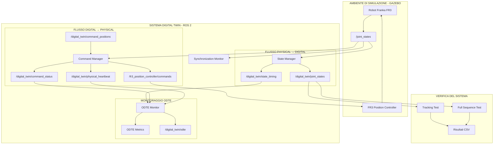
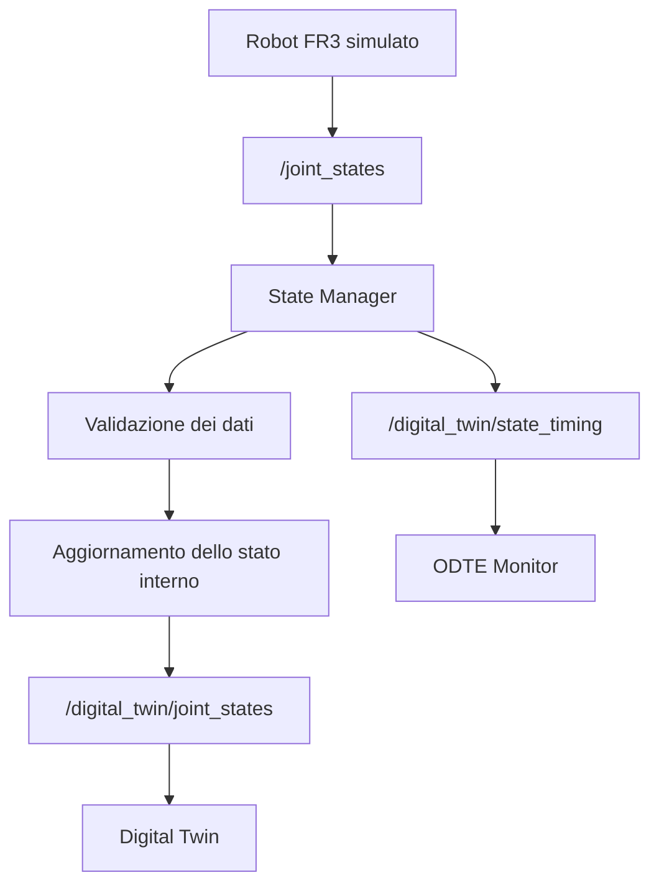
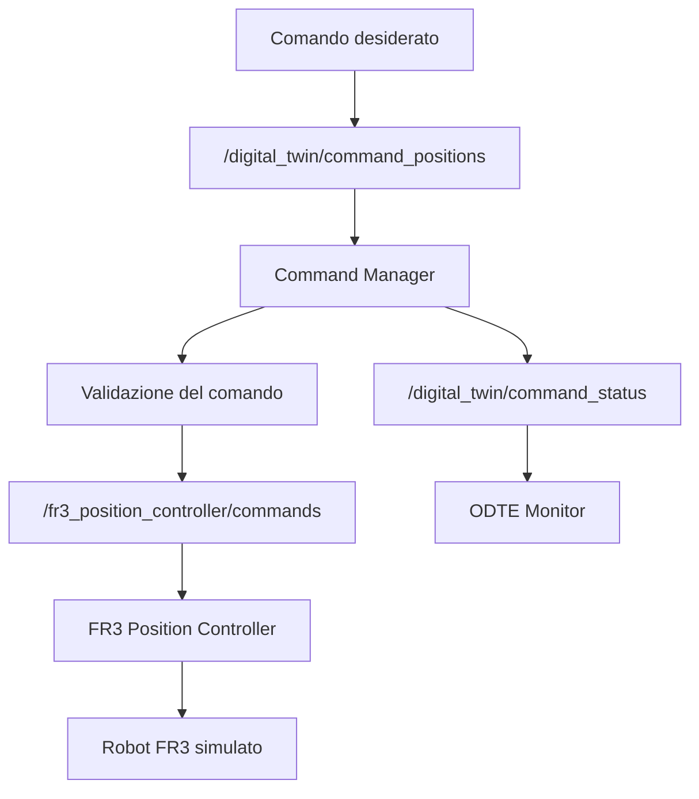
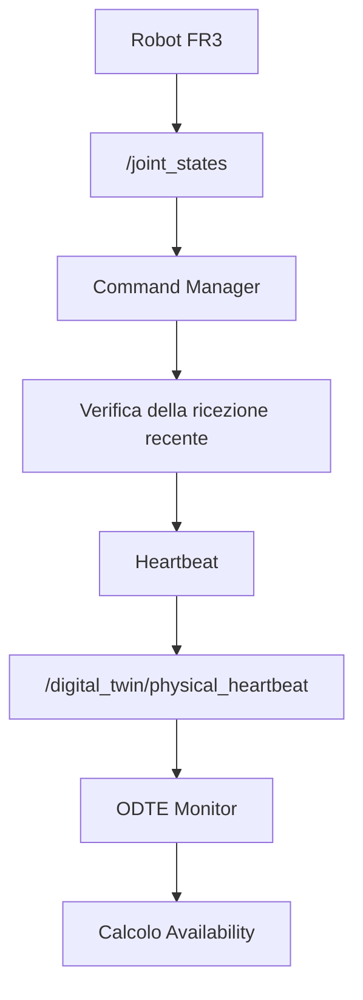

# Architettura del sistema

## 1. Panoramica

Il sistema implementa un Digital Twin del robot Franka FR3 attraverso un'architettura modulare basata su ROS 2 Jazzy.

L'architettura è organizzata intorno a due flussi principali:

- **Physical → Digital (P→D):** acquisizione dello stato articolare del robot e aggiornamento della sua rappresentazione digitale.
- **Digital → Physical (D→P):** invio dei comandi di posizione dal Digital Twin al robot simulato.

I componenti comunicano attraverso topic ROS 2, utilizzando messaggi standard e messaggi JSON per lo scambio delle informazioni di monitoraggio.

L'architettura comprende inoltre un sistema di monitoraggio della sincronizzazione e un prototipo sperimentale per il calcolo della metrica ODTE.

---

## 2. Architettura complessiva

L'architettura complessiva del Digital Twin è rappresentata nello schema seguente.

Il sistema è organizzato intorno a due flussi di comunicazione principali, che collegano il robot Franka FR3 simulato alla sua rappresentazione digitale:

- **Physical → Digital:** trasferimento dello stato articolare dal robot al Digital Twin.
- **Digital → Physical:** trasferimento dei comandi di posizione dal Digital Twin al robot.

I due flussi sono gestiti da nodi ROS 2 distinti e monitorati attraverso componenti dedicati.

### Schema generale



### Descrizione dell'architettura

L'architettura può essere suddivisa in quattro aree funzionali:

1. **Ambiente di simulazione:** comprende il robot Franka FR3 simulato in Gazebo e il controller responsabile dell'esecuzione dei comandi di posizione. Il robot pubblica il proprio stato articolare attraverso `/joint_states`.

2. **Gestione del Digital Twin:** comprende lo State Manager e il Command Manager. Il primo acquisisce e pubblica lo stato articolare, mentre il secondo gestisce i comandi diretti al robot.

3. **Monitoraggio:** comprende il Synchronization Monitor e l'ODTE Monitor. Il primo controlla la freschezza degli aggiornamenti, mentre il secondo elabora le informazioni temporali, gli eventi relativi ai comandi e gli heartbeat per stimare le componenti della metrica ODTE.

4. **Verifica del sistema:** comprende i moduli Tracking Test e Full Sequence Test, utilizzati per verificare il raggiungimento delle posizioni desiderate e l'allineamento tra lo stato del robot e quello del Digital Twin. I risultati vengono registrati in file CSV.

I collegamenti tra i componenti rappresentano i principali flussi di dati attraverso i topic ROS 2. Lo schema fornisce quindi una visione d'insieme delle interazioni tra simulazione, rappresentazione digitale, gestione dei comandi e monitoraggio.

---

## 3. Componenti principali

### 3.1 State Manager

Il nodo `state_manager` gestisce il flusso Physical → Digital.

Riceve gli aggiornamenti articolari dal topic `/joint_states` e verifica la validità dei dati prima di aggiornare la rappresentazione digitale.

In particolare:

- Controlla la corrispondenza tra nomi dei giunti e posizioni.
- Verifica la presenza delle sette articolazioni del braccio FR3.
- Controlla che le posizioni siano valori finiti.
- Organizza i dati articolari secondo un ordine deterministico.
- Aggiorna lo stato interno del Digital Twin.
- Pubblica lo stato elaborato su `/digital_twin/joint_states`.

Il nodo raccoglie inoltre informazioni temporali relative all'aggiornamento:

- Timestamp di generazione dello stato.
- Timestamp di ricezione.
- Tempo di elaborazione del callback.

Queste informazioni vengono pubblicate su `/digital_twin/state_timing` e utilizzate dall'ODTE Monitor.

### 3.2 Command Manager

Il nodo `command_manager` gestisce il flusso Digital → Physical.

Riceve un array di posizioni desiderate attraverso `/digital_twin/command_positions` e verifica la validità del comando prima di inoltrarlo al controller del robot.

La validazione comprende:

- Presenza esattamente di sette valori.
- Validità numerica dei valori ricevuti.
- Assenza di valori non finiti.
- Assenza di altri comandi in esecuzione.

Quando un comando viene accettato, il nodo gli assegna un identificativo e lo inoltra al controller attraverso `/fr3_position_controller/commands`.

Il completamento viene verificato confrontando le posizioni articolari osservate con quelle richieste. Il comando viene considerato completato quando tutte le articolazioni raggiungono la tolleranza prevista e mantengono tale condizione per il tempo stabilito.

Il nodo pubblica gli aggiornamenti sullo stato dei comandi attraverso `/digital_twin/command_status`.

### 3.3 Synchronization Monitor

Il nodo `synchronization_monitor` controlla la freschezza degli aggiornamenti ricevuti attraverso `/joint_states`.

Il suo obiettivo è individuare eventuali interruzioni nella ricezione dei dati e segnalare il conseguente stato di mancato aggiornamento.

Il monitor verifica quindi la continuità della comunicazione tra il robot simulato e il sistema di acquisizione.

Questa funzionalità è distinta dal confronto diretto tra le posizioni del robot e quelle del Digital Twin, che viene invece effettuato dai test di tracking.

### 3.4 ODTE Monitor

Il nodo `odte_monitor` raccoglie le informazioni prodotte dagli altri componenti per stimare la metrica ODTE.

Si sottoscrive a tre topic:

- `/digital_twin/state_timing`
- `/digital_twin/physical_heartbeat`
- `/digital_twin/command_status`

Il monitor elabora separatamente i due flussi di comunicazione e pubblica i risultati su `/digital_twin/odte`.

Il calcolo delle componenti matematiche è supportato dal modulo `odte_metrics.py`, che contiene le funzioni per Timeliness, Reliability e ODTE.

---

## 4. Flussi di comunicazione

### 4.1 Flusso Physical → Digital

Il flusso Physical → Digital descrive il trasferimento dello stato articolare dal robot simulato alla sua rappresentazione digitale.



Il robot pubblica periodicamente lo stato delle articolazioni attraverso `/joint_states`.

Lo State Manager riceve i messaggi, verifica la validità delle informazioni e aggiorna la rappresentazione digitale interna.

Successivamente pubblica lo stato articolare filtrato su `/digital_twin/joint_states`.

Parallelamente, le informazioni temporali vengono inviate all'ODTE Monitor per la valutazione del flusso Physical → Digital.

### 4.2 Flusso Digital → Physical

Il flusso Digital → Physical descrive l'invio dei comandi dal Digital Twin al robot simulato.



Il comando viene ricevuto dal Command Manager, che ne verifica la validità.

Se il comando viene accettato, le posizioni desiderate vengono inoltrate al controller del robot.

Il Command Manager monitora successivamente il raggiungimento degli obiettivi e pubblica gli aggiornamenti relativi allo stato del comando.

Queste informazioni vengono utilizzate dall'ODTE Monitor per valutare l'affidabilità e la tempestività del flusso Digital → Physical.

---

## 5. Monitoraggio della disponibilità

Il Command Manager pubblica periodicamente un heartbeat attraverso il topic `/digital_twin/physical_heartbeat`.

Il messaggio è di tipo `std_msgs/msg/Bool` e indica se il nodo ha ricevuto recentemente aggiornamenti dello stato articolare del robot.

La frequenza di pubblicazione prevista è pari a 2 Hz.

Il flusso di monitoraggio è rappresentato di seguito:



L'ODTE Monitor utilizza gli heartbeat positivi ricevuti all'interno di una finestra temporale per stimare la disponibilità del percorso Digital → Physical.

Gli heartbeat non positivi aggiornano lo stato di disponibilità, mentre le osservazioni positive vengono considerate nel calcolo della componente Availability.

---

## 6. Architettura della metrica ODTE

La metrica ODTE (Overall Digital Twin Entanglement) viene utilizzata nel progetto come riferimento per valutare il comportamento dei due flussi di comunicazione.

La relazione implementata per il calcolo complessivo è:

```text
ODTE = T × R × A
```

dove:

| Componente | Significato |
|---|---|
| `T` | Timeliness |
| `R` | Reliability |
| `A` | Availability |

Tutte le componenti sono rappresentate attraverso valori compresi tra 0 e 1.

### 6.1 Physical → Digital

Per il percorso Physical → Digital:

- **Timeliness:** valuta se gli aggiornamenti arrivano entro la soglia temporale desiderata.
- **Reliability:** confronta la frequenza di aggiornamento misurata con quella attesa.
- **Availability:** nella versione attuale viene impostata a 1.

Le informazioni utilizzate per questo calcolo provengono dal topic `/digital_twin/state_timing`.

### 6.2 Digital → Physical

Per il percorso Digital → Physical:

- **Timeliness:** considera la proporzione di comandi accettati e completati entro la soglia temporale prevista.
- **Reliability:** considera la proporzione di comandi completati con successo rispetto a quelli accettati.
- **Availability:** viene stimata attraverso gli heartbeat positivi ricevuti nella finestra temporale di osservazione.

I comandi rifiutati non vengono conteggiati tra quelli accettati.

In assenza di comandi accettati, Timeliness e Reliability vengono impostate a zero. Il monitor continua comunque a pubblicare i risultati.

### 6.3 Pubblicazione dei risultati

L'ODTE Monitor pubblica i risultati attraverso `/digital_twin/odte`, utilizzando messaggi `std_msgs/msg/String` contenenti dati JSON.

La struttura dei messaggi distingue le due direzioni attraverso il campo `direction`.

Esempio:

```json
{
  "direction": "digital_to_physical",
  "timeliness": 1.0,
  "reliability": 1.0,
  "availability": 1.0,
  "odte": 1.0
}
```

**Nota:** l'implementazione ODTE costituisce un prototipo sperimentale. I valori prodotti descrivono il comportamento delle componenti attualmente implementate e non rappresentano ancora una misura scientificamente validata della qualità del Digital Twin.

---

## 7. Interfacce ROS 2

La comunicazione tra i componenti avviene attraverso i seguenti topic:

| Topic | Tipo di messaggio | Publisher | Subscriber |
|---|---|---|---|
| `/joint_states` | `sensor_msgs/msg/JointState` | Robot / controller | State Manager, Synchronization Monitor, Command Manager |
| `/digital_twin/joint_states` | `sensor_msgs/msg/JointState` | State Manager | Componenti di verifica dello stato |
| `/digital_twin/state_timing` | `std_msgs/msg/String` | State Manager | ODTE Monitor |
| `/digital_twin/command_positions` | `std_msgs/msg/Float64MultiArray` | Interfaccia di comando | Command Manager |
| `/fr3_position_controller/commands` | `std_msgs/msg/Float64MultiArray` | Command Manager | FR3 Position Controller |
| `/digital_twin/command_status` | `std_msgs/msg/String` | Command Manager | ODTE Monitor |
| `/digital_twin/physical_heartbeat` | `std_msgs/msg/Bool` | Command Manager | ODTE Monitor |
| `/digital_twin/odte` | `std_msgs/msg/String` | ODTE Monitor | Interfaccia di monitoraggio |

---

## 8. Organizzazione dei moduli

Il package `franka_dt` separa le responsabilità del sistema in moduli distinti.

| Modulo | Responsabilità |
|---|---|
| `state_manager.py` | Acquisizione, validazione e pubblicazione dello stato articolare |
| `command_manager.py` | Validazione, invio e monitoraggio dei comandi |
| `synchronization_monitor.py` | Monitoraggio della freschezza degli aggiornamenti |
| `odte_metrics.py` | Funzioni matematiche per il calcolo delle componenti ODTE |
| `odte_monitor.py` | Raccolta delle informazioni e pubblicazione delle metriche ODTE |
| `tracking_test.py` | Verifica del raggiungimento di posizioni articolari selezionate |
| `full_sequence_test.py` | Verifica di una sequenza di movimenti sulle sette articolazioni |

I test automatici sono organizzati separatamente nella cartella `test/` e verificano il comportamento dei principali moduli del package.

---

## 9. Considerazioni progettuali

L'architettura è stata progettata secondo alcuni principi fondamentali:

- **Modularità:** ogni nodo ROS 2 gestisce una responsabilità specifica.
- **Separazione dei flussi:** acquisizione dello stato e invio dei comandi sono gestiti da componenti distinti.
- **Validazione dei dati:** i messaggi vengono controllati prima di essere utilizzati dai componenti successivi.
- **Monitoraggio:** le informazioni temporali, gli eventi relativi ai comandi e gli heartbeat consentono di osservare il comportamento dei flussi.
- **Estendibilità:** i moduli possono essere modificati o ampliati senza dover riprogettare l'intera architettura.

La separazione tra i flussi Physical → Digital e Digital → Physical permette inoltre di analizzare separatamente i due percorsi e di individuare eventuali criticità nella comunicazione tra robot e Digital Twin.

Il sistema costituisce una base sperimentale per lo sviluppo e la valutazione di un Digital Twin del Franka FR3. In particolare, il monitoraggio ODTE potrà essere ulteriormente raffinato attraverso verifiche teoriche e sperimentali delle singole componenti.
