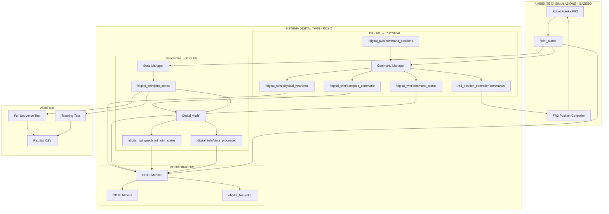
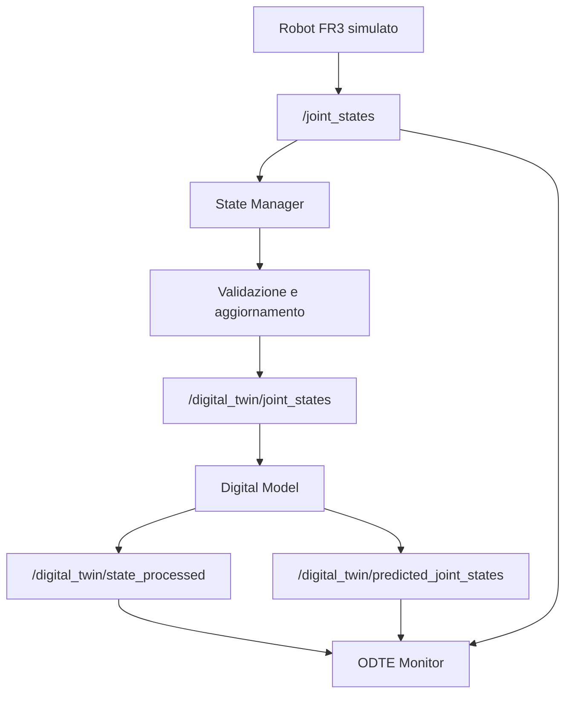
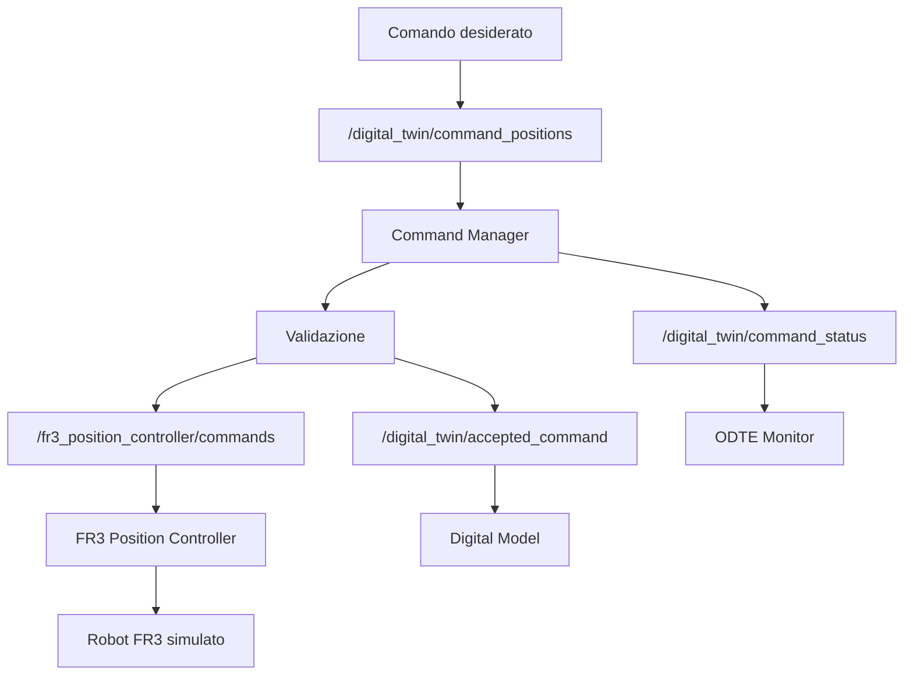

# Architettura del sistema

## 1. Panoramica

Il progetto implementa un Digital Twin del robot Franka FR3 attraverso un'architettura modulare basata su ROS 2 Jazzy e Gazebo.

Il sistema è organizzato intorno a due flussi di comunicazione:

- **Physical → Digital (P→D):** acquisizione dello stato articolare del robot e aggiornamento della rappresentazione digitale.
- **Digital → Physical (D→P):** invio dei comandi di posizione dal Digital Twin al robot simulato.

L'architettura comprende inoltre un sistema di diagnostica della sincronizzazione tra Physical Twin e Digital Twin, integrato nel nodo `odte_monitor`, e un prototipo sperimentale per il calcolo della metrica ODTE (Overall Digital Twin Entanglement).

---

## 2. Architettura complessiva

Il sistema è composto da quattro aree funzionali:

- **Ambiente fisico simulato:** robot Franka FR3, controller e pubblicazione degli stati articolari.
- **Gestione del Digital Twin:** acquisizione degli stati, aggiornamento del modello digitale e gestione dei comandi.
- **Monitoraggio:** calcolo delle componenti ODTE e diagnostica della sincronizzazione.
- **Verifica:** test di tracking e sequenze di movimento per valutare il comportamento del sistema.

### Schema generale



---

## 3. Componenti principali

### 3.1 State Manager

Il nodo `state_manager` gestisce l'acquisizione e la validazione dello stato articolare del Physical Twin.

Si sottoscrive al topic `/joint_states` e verifica:

- La corrispondenza tra nomi delle articolazioni e posizioni.
- La presenza delle sette articolazioni del Franka FR3.
- La validità numerica dei valori ricevuti.

Dopo la validazione, organizza i dati secondo un ordine deterministico e pubblica lo stato elaborato su `/digital_twin/joint_states`.

Il nodo pubblica inoltre informazioni temporali relative alla ricezione e all'elaborazione degli stati attraverso `/digital_twin/state_timing`. Questo flusso è separato da quello utilizzato dall'ODTE Monitor.

### 3.2 Command Manager

Il nodo `command_manager` gestisce il flusso Digital → Physical.

Riceve le posizioni desiderate attraverso `/digital_twin/command_positions` e verifica la validità del comando prima di inoltrarlo al controller.

La validazione comprende:

- Presenza di esattamente sette valori.
- Validità numerica e assenza di valori non finiti.
- Assenza di altri comandi in esecuzione.

Quando un comando viene accettato, il nodo gli assegna un identificativo e pubblica le informazioni relative all'accettazione attraverso `/digital_twin/accepted_command`.

Il comando viene inoltrato al controller tramite `/fr3_position_controller/commands`.

Il completamento viene verificato confrontando le posizioni articolari osservate con quelle desiderate. Il nodo pubblica gli aggiornamenti sullo stato del comando attraverso `/digital_twin/command_status`.

Il Command Manager pubblica inoltre un heartbeat su `/digital_twin/physical_heartbeat`, utilizzato per monitorare la disponibilità del sistema.

### 3.3 Digital Model

Il nodo `digital_model` gestisce una rappresentazione digitale autonoma del robot Franka FR3.

Si sottoscrive a:

- `/digital_twin/joint_states`, per ricevere gli stati articolari elaborati dallo State Manager.
- `/digital_twin/accepted_command`, per ricevere i comandi accettati dal Command Manager.

Il primo stato fisico valido viene utilizzato per inizializzare la rappresentazione digitale. Successivamente, il modello evolve autonomamente sulla base dei comandi ricevuti, senza correggere continuamente la traiettoria utilizzando gli aggiornamenti fisici.

Per ciascun comando accettato, genera una traiettoria articolare basata su un profilo trapezoidale o triangolare, configurato attraverso i limiti di velocità, accelerazione e decelerazione.

Il nodo pubblica:

- `/digital_twin/predicted_joint_states`, contenente le posizioni e le velocità articolari previste.
- `/digital_twin/state_processed`, contenente le informazioni temporali relative all'elaborazione degli aggiornamenti fisici.

Il secondo flusso viene utilizzato dall'ODTE Monitor per valutare la Timeliness del percorso Physical → Digital.

### 3.4 ODTE Monitor

Il nodo `odte_monitor` svolge due funzioni principali:

- Calcolo sperimentale della metrica ODTE per i due flussi di comunicazione.
- Diagnostica della sincronizzazione tra Physical Twin e Digital Twin.

Si sottoscrive ai seguenti topic:

- `/digital_twin/state_processed`
- `/digital_twin/physical_heartbeat`
- `/digital_twin/command_status`
- `/joint_states`
- `/digital_twin/predicted_joint_states`

Per la diagnostica, associa gli stati articolari del Physical Twin e del Digital Twin utilizzando i rispettivi timestamp, entro una tolleranza temporale configurabile.

Per ogni coppia di stati associati calcola gli errori articolari, il Mean Absolute Error (MAE), il massimo errore e la differenza temporale tra gli aggiornamenti.

Lo stato della sincronizzazione può assumere tre valori:

- `SYNCHRONIZED`: i dati sono aggiornati e temporalmente compatibili.
- `TEMPORAL_MISMATCH`: i dati sono disponibili, ma non è possibile associare correttamente gli aggiornamenti.
- `DATA_UNAVAILABLE`: uno o entrambi i flussi non forniscono dati sufficientemente aggiornati.

Le informazioni diagnostiche sono mantenute separate dal calcolo delle componenti ODTE e non ne modificano il risultato.

---

## 4. Flussi di comunicazione

### 4.1 Physical → Digital

Il flusso Physical → Digital trasferisce lo stato articolare dal robot simulato alla rappresentazione digitale.



Il robot pubblica periodicamente il proprio stato articolare attraverso `/joint_states`.

Lo State Manager verifica i dati ricevuti e pubblica lo stato elaborato su `/digital_twin/joint_states`.

Il Digital Model utilizza queste informazioni per aggiornare la propria rappresentazione e pubblica gli stati articolari previsti su `/digital_twin/predicted_joint_states`.

Gli eventi di elaborazione vengono pubblicati su `/digital_twin/state_processed` e utilizzati dall'ODTE Monitor per la valutazione temporale del flusso.

L'ODTE Monitor confronta inoltre gli stati articolari fisici e digitali per diagnosticare eventuali disallineamenti.

### 4.2 Digital → Physical

Il flusso Digital → Physical trasferisce i comandi di posizione dal Digital Twin al robot simulato.



Il Command Manager verifica la validità dei comandi ricevuti.

Se un comando viene accettato, il nodo pubblica le relative informazioni su `/digital_twin/accepted_command` e inoltra le posizioni desiderate al controller tramite `/fr3_position_controller/commands`.

Il Digital Model riceve il comando accettato, mentre il Command Manager monitora il raggiungimento delle posizioni obiettivo e pubblica gli aggiornamenti attraverso `/digital_twin/command_status`.

Questi eventi vengono utilizzati dall'ODTE Monitor per valutare il comportamento del flusso Digital → Physical.

---

## 5. Monitoraggio della disponibilità

La disponibilità del sistema viene monitorata attraverso il topic `/digital_twin/physical_heartbeat`, pubblicato periodicamente dal Command Manager.

Il messaggio è di tipo `std_msgs/msg/Bool` e indica se il nodo ha ricevuto recentemente aggiornamenti dello stato articolare del robot.

La frequenza di pubblicazione prevista è pari a 2 Hz.

L'ODTE Monitor utilizza gli heartbeat positivi e non positivi per stimare la componente Availability del flusso Digital → Physical.

---

## 6. Metrica ODTE

La metrica ODTE (Overall Digital Twin Entanglement) viene utilizzata come riferimento sperimentale per valutare il comportamento dei due flussi di comunicazione.

La relazione implementata è:

```text
ODTE = T × R × A
```

Dove:

| Componente | Significato |
|---|---|
| `T` | Timeliness |
| `R` | Reliability |
| `A` | Availability |

Le componenti sono rappresentate da valori compresi tra 0 e 1.

### 6.1 Physical → Digital

Per il flusso Physical → Digital:

- **Timeliness:** valuta la proporzione di aggiornamenti elaborati entro la soglia temporale desiderata di 50 ms. Utilizza gli eventi pubblicati su `/digital_twin/state_processed`.
- **Reliability:** confronta la frequenza di aggiornamento misurata con quella attesa, pari a 100 Hz.
- **Availability:** nella versione attuale viene impostata a 1.

### 6.2 Digital → Physical

Per il flusso Digital → Physical:

- **Timeliness:** considera la proporzione di comandi accettati e completati entro la soglia temporale prevista.
- **Reliability:** considera la proporzione di comandi completati con successo rispetto a quelli accettati.
- **Availability:** viene stimata attraverso gli heartbeat ricevuti nella finestra temporale di osservazione.

I comandi rifiutati non vengono conteggiati tra quelli accettati.

### 6.3 Pubblicazione dei risultati

L'ODTE Monitor pubblica i risultati attraverso `/digital_twin/odte`, utilizzando messaggi `std_msgs/msg/String` contenenti dati JSON.

Le due direzioni vengono valutate separatamente e producono due messaggi distinti, identificati dal campo `direction`:

- `physical_to_digital`
- `digital_to_physical`

Ogni messaggio contiene le componenti Timeliness, Reliability e Availability e il relativo valore ODTE.

I risultati vengono pubblicati sullo stesso topic, ma rappresentano due valutazioni indipendenti dei flussi di comunicazione.

**Nota:** l'implementazione costituisce un prototipo sperimentale e richiede ulteriori verifiche teoriche e sperimentali per la validazione delle componenti.

---

## 7. Interfacce ROS 2

La comunicazione tra i componenti avviene attraverso i seguenti topic:

| Topic | Tipo di messaggio | Publisher | Subscriber |
|---|---|---|---|
| `/joint_states` | `sensor_msgs/msg/JointState` | Robot / controller | State Manager, Command Manager, ODTE Monitor |
| `/digital_twin/joint_states` | `sensor_msgs/msg/JointState` | State Manager | Digital Model, Tracking Test, Full Sequence Test |
| `/digital_twin/state_timing` | `std_msgs/msg/String` | State Manager | — |
| `/digital_twin/accepted_command` | `std_msgs/msg/String` | Command Manager | Digital Model |
| `/digital_twin/state_processed` | `std_msgs/msg/String` | Digital Model | ODTE Monitor |
| `/digital_twin/predicted_joint_states` | `sensor_msgs/msg/JointState` | Digital Model | ODTE Monitor |
| `/digital_twin/command_positions` | `std_msgs/msg/Float64MultiArray` | Interfaccia di comando | Command Manager |
| `/fr3_position_controller/commands` | `std_msgs/msg/Float64MultiArray` | Command Manager | FR3 Position Controller |
| `/digital_twin/command_status` | `std_msgs/msg/String` | Command Manager | ODTE Monitor |
| `/digital_twin/physical_heartbeat` | `std_msgs/msg/Bool` | Command Manager | ODTE Monitor |
| `/digital_twin/odte` | `std_msgs/msg/String` | ODTE Monitor | Interfaccia di monitoraggio |

---

## 8. Organizzazione dei moduli

Il package `franka_dt` è organizzato in moduli con responsabilità distinte:

| Modulo | Responsabilità |
|---|---|
| `state_manager.py` | Acquisizione, validazione e pubblicazione dello stato articolare |
| `command_manager.py` | Validazione, invio e monitoraggio dei comandi |
| `digital_model.py` | Aggiornamento della rappresentazione digitale e pubblicazione degli stati previsti e degli eventi di elaborazione |
| `odte_metrics.py` | Funzioni matematiche per il calcolo delle componenti ODTE |
| `odte_monitor.py` | Calcolo ODTE e diagnostica della sincronizzazione |
| `tracking_test.py` | Verifica del raggiungimento di posizioni articolari selezionate |
| `full_sequence_test.py` | Verifica di sequenze di movimento sulle sette articolazioni |

I test automatici sono organizzati separatamente nella cartella `test/`.

---

## 9. Considerazioni progettuali

L'architettura si basa sui seguenti principi:

- **Modularità:** ogni nodo gestisce una responsabilità specifica.
- **Separazione dei flussi:** acquisizione dello stato e invio dei comandi sono gestiti da componenti distinti.
- **Validazione:** i dati vengono controllati prima di essere utilizzati dai componenti successivi.
- **Monitoraggio:** le informazioni temporali, gli eventi relativi ai comandi e gli heartbeat permettono di osservare il comportamento dei due flussi.
- **Estendibilità:** i moduli possono essere modificati o ampliati senza riprogettare l'intero sistema.
- **Verifica sperimentale:** il comportamento del sistema viene analizzato attraverso test di tracking, sequenze di movimento e valutazione delle componenti ODTE.
