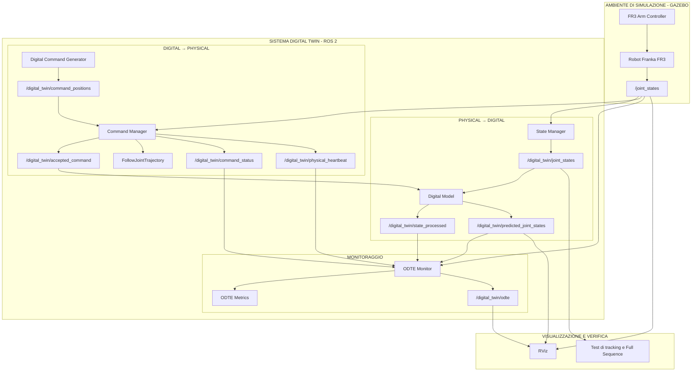
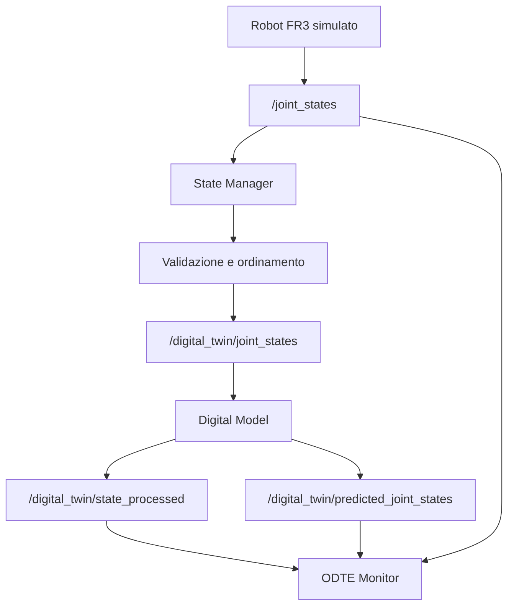
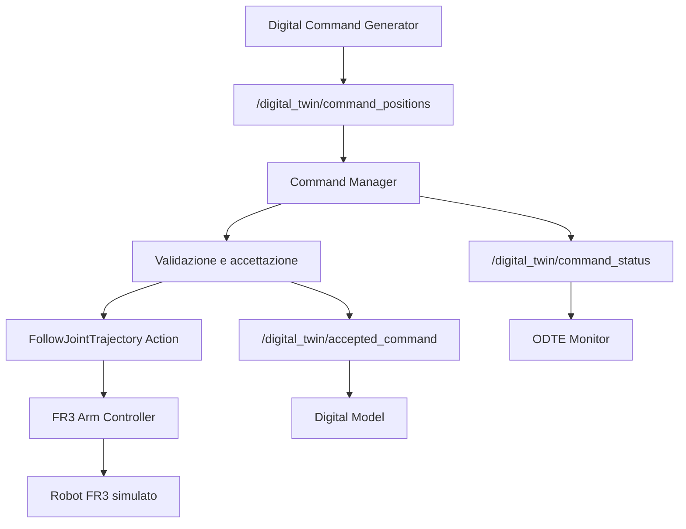

# Architettura del sistema

## 1. Panoramica

Il progetto implementa un Digital Twin del braccio robotico Franka FR3 attraverso un'architettura modulare basata su ROS 2 Jazzy e Gazebo.

Il sistema realizza una comunicazione bidirezionale tra Physical Twin (PT) e Digital Twin (DT), articolata in due flussi:

- **Physical → Digital (P→D):** acquisizione dello stato articolare del robot e aggiornamento della rappresentazione digitale.
- **Digital → Physical (D→P):** generazione e invio di comandi di posizione dal Digital Twin al robot simulato.

L'architettura comprende inoltre un sistema di monitoraggio che calcola sperimentalmente le metriche ODTE (Overall Digital Twin Entanglement) e analizza la sincronizzazione tra le due rappresentazioni.

---

## 2. Architettura complessiva

Il sistema è organizzato in quattro aree funzionali:

- **Ambiente di simulazione:** robot Franka FR3, controller e pubblicazione degli stati articolari.
- **Gestione del Digital Twin:** acquisizione degli stati, aggiornamento del modello digitale e generazione dei comandi.
- **Monitoraggio:** calcolo delle metriche ODTE e diagnostica della sincronizzazione.
- **Visualizzazione e verifica:** rappresentazione dei due bracci in RViz e test del comportamento del sistema.

### Schema generale



---

## 3. Componenti principali

### 3.1 Digital Command Generator

Il nodo `digital_command_generator.py` genera i comandi di posizione da inviare al robot simulato e li pubblica attraverso `/digital_twin/command_positions`.

Supporta due modalità operative:

- **Tracking:** acquisisce lo stato articolare corrente e genera un comando applicando variazioni alle posizioni di alcune articolazioni.
- **Full Sequence:** genera una sequenza di comandi di posizione, consentendo di eseguire più movimenti consecutivi.

I comandi generati vengono ricevuti dal Command Manager, che ne gestisce la validazione e l'invio al controller.

### 3.2 Command Manager

Il nodo `command_manager.py` gestisce l'invio dei comandi di movimento dal Digital Twin al robot simulato.

Riceve i comandi generati dal Digital Command Generator e ne verifica la validità prima di inoltrarli al controller del robot attraverso l'Action ROS 2 `FollowJointTrajectory`, disponibile su:

`/fr3_arm_controller/follow_joint_trajectory`

Il nodo gestisce l'accettazione e l'esecuzione dei comandi, monitorandone l'esito e gli eventuali timeout. Pubblica gli aggiornamenti sullo stato dei comandi attraverso `/digital_twin/command_status`.

Inoltre, pubblica un heartbeat periodico su `/digital_twin/physical_heartbeat`, utilizzato per monitorare la disponibilità della comunicazione con il robot.

### 3.3 State Manager

Il nodo `state_manager.py` acquisisce lo stato articolare del robot dal topic `/joint_states` e ne verifica la validità, controllando la presenza delle sette articolazioni e la coerenza dei valori ricevuti.

Una volta elaborati i dati, pubblica lo stato articolare aggiornato su `/digital_twin/joint_states`, mantenendo un ordine deterministico dei giunti.

Gestisce inoltre le informazioni temporali associate agli aggiornamenti, utilizzate per monitorare la comunicazione nella direzione Physical → Digital.

### 3.4 Digital Model

Il nodo `digital_model.py` gestisce la rappresentazione digitale del robot Franka FR3.

Riceve:
- `/digital_twin/joint_states`, contenente gli stati articolari elaborati dallo State Manager.
- `/digital_twin/accepted_command`, contenente le informazioni sui comandi accettati dal Command Manager.

Il primo stato fisico valido viene utilizzato per inizializzare la rappresentazione digitale. Successivamente, il modello elabora autonomamente i comandi accettati, generando l'evoluzione prevista dello stato articolare.

La traiettoria viene calcolata utilizzando profili trapezoidali o triangolari, sulla base dei limiti configurati di velocità, accelerazione e decelerazione.

Il nodo pubblica:
- `/digital_twin/predicted_joint_states`, contenente gli stati articolari previsti dal modello.
- `/digital_twin/state_processed`, contenente le informazioni temporali relative all'elaborazione degli aggiornamenti fisici.

### 3.5 ODTE Monitor e diagnostica della sincronizzazione

Il nodo `odte_monitor.py` svolge due funzioni distinte:

1. Calcolo sperimentale delle metriche ODTE per le direzioni Physical → Digital e Digital → Physical.
2. Diagnostica della sincronizzazione tra Physical Twin e Digital Twin.

Per la diagnostica, il nodo confronta gli stati articolari ricevuti da `/joint_states` e `/digital_twin/predicted_joint_states`, associandoli attraverso i rispettivi timestamp entro una tolleranza temporale configurabile.

Per ogni coppia di stati associati vengono calcolati gli errori articolari e le relative statistiche, tra cui il Mean Absolute Error (MAE), l'errore massimo e la differenza temporale tra gli aggiornamenti.

Lo stato della sincronizzazione può assumere tre valori:

- `SYNCHRONIZED`: i dati sono disponibili e temporalmente compatibili.
- `TEMPORAL_MISMATCH`: i dati sono disponibili, ma non è possibile associare correttamente gli aggiornamenti.
- `DATA_UNAVAILABLE`: uno o entrambi i flussi non forniscono dati sufficientemente aggiornati.

La diagnostica è mantenuta separata dal calcolo delle componenti ODTE e non ne modifica direttamente i risultati.

---

## 4. Flussi di comunicazione

### 4.1 Physical → Digital

Il flusso Physical → Digital trasferisce lo stato articolare dal robot simulato alla rappresentazione digitale.



Il robot pubblica periodicamente il proprio stato articolare attraverso `/joint_states`.

Lo State Manager verifica i dati ricevuti e pubblica lo stato elaborato su `/digital_twin/joint_states`.

Il Digital Model utilizza queste informazioni per inizializzare la propria rappresentazione e gestire gli aggiornamenti successivi. Pubblica quindi gli stati articolari previsti e le informazioni temporali relative all'elaborazione.

L'ODTE Monitor utilizza questi dati per valutare il flusso e confrontare gli stati fisici e digitali ai fini della diagnostica.

### 4.2 Digital → Physical

Il flusso Digital → Physical trasferisce i comandi di posizione dal Digital Twin al robot simulato.



Il Digital Command Generator produce i comandi di posizione e li pubblica su `/digital_twin/command_positions`.

Il Command Manager verifica i comandi ricevuti. Se vengono accettati, pubblica le relative informazioni su `/digital_twin/accepted_command` e li inoltra al controller tramite l'Action `FollowJointTrajectory`.

Il Digital Model utilizza i comandi accettati per generare la traiettoria prevista, mentre il Command Manager monitora l'esecuzione e pubblica il relativo stato su `/digital_twin/command_status`.

Queste informazioni vengono utilizzate dall'ODTE Monitor per valutare il comportamento del flusso Digital → Physical.

---

## 5. Monitoraggio della disponibilità

Il Command Manager pubblica periodicamente un heartbeat sul topic `/digital_twin/physical_heartbeat`.

Il messaggio, di tipo `std_msgs/msg/Bool`, viene utilizzato per segnalare la disponibilità degli aggiornamenti dello stato articolare del robot.

L'ODTE Monitor utilizza gli heartbeat ricevuti nella finestra temporale di osservazione per stimare la componente Availability del flusso Digital → Physical.

---

## 6. Metrica ODTE

La metrica ODTE (Overall Digital Twin Entanglement) viene utilizzata come riferimento sperimentale per valutare il comportamento dei due flussi di comunicazione.

La relazione implementata è:

```text
ODTE = T × R × A
```

Dove:

| Componente | Significato |
|---|---|
| `T` | Timeliness |
| `R` | Reliability |
| `A` | Availability |

Le componenti assumono valori compresi tra 0 e 1.

### 6.1 Physical → Digital

Per il flusso Physical → Digital:

- **Timeliness:** valuta la tempestività degli aggiornamenti elaborati, utilizzando gli eventi pubblicati su `/digital_twin/state_processed` e una soglia temporale configurata.
- **Reliability:** valuta la frequenza degli aggiornamenti ricevuti rispetto alla frequenza attesa.
- **Availability:** nella versione attuale del prototipo viene impostata a 1.

### 6.2 Digital → Physical

Per il flusso Digital → Physical:

- **Timeliness:** viene valutata attraverso le informazioni temporali associate alle osservazioni e ai comandi, secondo la logica implementata nel monitor.
- **Reliability:** considera l'esito dei comandi accettati, distinguendo quelli completati con successo da quelli non completati correttamente.
- **Availability:** viene stimata attraverso gli heartbeat ricevuti nella finestra temporale di osservazione.

I comandi rifiutati non vengono conteggiati tra quelli accettati.

### 6.3 Pubblicazione dei risultati

Il nodo ODTE Monitor pubblica i risultati attraverso `/digital_twin/odte`, utilizzando messaggi `std_msgs/msg/String` contenenti dati JSON.

Le due direzioni vengono valutate separatamente e identificate dal campo `direction`:

- `physical_to_digital`
- `digital_to_physical`

Ogni risultato contiene le componenti Timeliness, Reliability e Availability e il relativo valore ODTE.

**Nota:** l'implementazione costituisce un prototipo sperimentale. Le formule e le modalità di calcolo delle componenti richiedono ulteriori verifiche teoriche e sperimentali prima di poter considerare validata la metrica.

---

## 7. Visualizzazione in RViz

Il sistema prevede la visualizzazione simultanea delle due rappresentazioni del robot Franka FR3 in RViz:

- **Physical Twin:** rappresentazione del robot simulato.
- **Digital Twin:** rappresentazione dello stato articolare previsto dal modello digitale.

La visualizzazione consente di osservare l'allineamento iniziale dei due bracci e di confrontarne il comportamento durante l'esecuzione dei movimenti.

Durante un movimento, entrambe le rappresentazioni devono aggiornarsi e seguire il movimento, mantenendo la corrispondenza tra le rispettive posizioni articolari.

L'interfaccia comprende inoltre una tabella dedicata al monitoraggio delle metriche ODTE, con i valori di Timeliness, Reliability, Availability e ODTE per entrambe le direzioni di comunicazione.

---

## 8. Interfacce ROS 2

La comunicazione tra i componenti avviene attraverso topic e Action ROS 2.

| Interfaccia | Tipo | Publisher / Server | Subscriber / Client |
|---|---|---|---|
| `/joint_states` | `sensor_msgs/msg/JointState` | Robot / controller | State Manager, Command Manager, ODTE Monitor |
| `/digital_twin/joint_states` | `sensor_msgs/msg/JointState` | State Manager | Digital Model, test |
| `/digital_twin/state_timing` | `std_msgs/msg/String` | State Manager | Componenti di monitoraggio temporale |
| `/digital_twin/command_positions` | `DigitalTwinCommand`  | Digital Command Generator | Command Manager |
| `/digital_twin/accepted_command` | `std_msgs/msg/String` | Command Manager | Digital Model |
| `/digital_twin/predicted_joint_states` | `sensor_msgs/msg/JointState` | Digital Model | ODTE Monitor, visualizzazione |
| `/digital_twin/state_processed` | `std_msgs/msg/String` | Digital Model | ODTE Monitor |
| `/digital_twin/command_status` | `std_msgs/msg/String` | Command Manager | ODTE Monitor |
| `/digital_twin/physical_heartbeat` | `std_msgs/msg/Bool` | Command Manager | ODTE Monitor |
| `/digital_twin/odte` | `std_msgs/msg/String` | ODTE Monitor | Interfaccia di monitoraggio |
| `/fr3_arm_controller/follow_joint_trajectory` | `control_msgs/action/FollowJointTrajectory` | FR3 Arm Controller | Command Manager |

---

## 9. Organizzazione dei moduli

Il package `franka_dt` è organizzato in moduli con responsabilità distinte:

| Modulo | Responsabilità |
|---|---|
| `digital_command_generator.py` | Generazione dei comandi nelle modalità Tracking e Full Sequence |
| `command_manager.py` | Validazione, invio e monitoraggio dei comandi |
| `state_manager.py` | Acquisizione, validazione e pubblicazione dello stato articolare |
| `digital_model.py` | Gestione del modello digitale e pubblicazione degli stati previsti |
| `odte_metrics.py` | Funzioni matematiche per il calcolo delle componenti ODTE |
| `odte_monitor.py` | Calcolo ODTE e diagnostica della sincronizzazione |
| `tracking_test.py` | Verifica del comportamento nella modalità Tracking |
| `full_sequence_test.py` | Verifica delle sequenze di movimento |

I test automatici sono organizzati separatamente nella cartella `test/`.

---

## 10. Considerazioni progettuali

L'architettura si basa sui seguenti principi:

- **Modularità:** ogni nodo gestisce responsabilità specifiche.
- **Separazione dei flussi:** acquisizione degli stati e invio dei comandi sono gestiti da componenti distinti.
- **Comunicazione bidirezionale:** il sistema gestisce sia gli aggiornamenti dal robot al Digital Twin sia i comandi nella direzione opposta.
- **Validazione:** gli stati e i comandi vengono verificati prima di essere utilizzati dai componenti successivi.
- **Monitoraggio:** le informazioni temporali, gli esiti dei comandi e gli heartbeat supportano la valutazione del comportamento del sistema.
- **Verifica sperimentale:** il comportamento del Digital Twin viene analizzato attraverso test funzionali, diagnostica della sincronizzazione e metriche ODTE.
